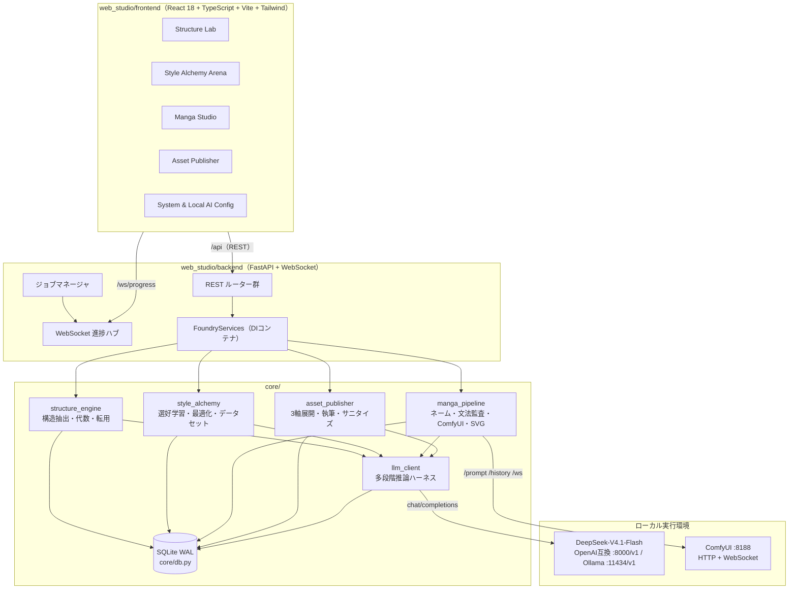
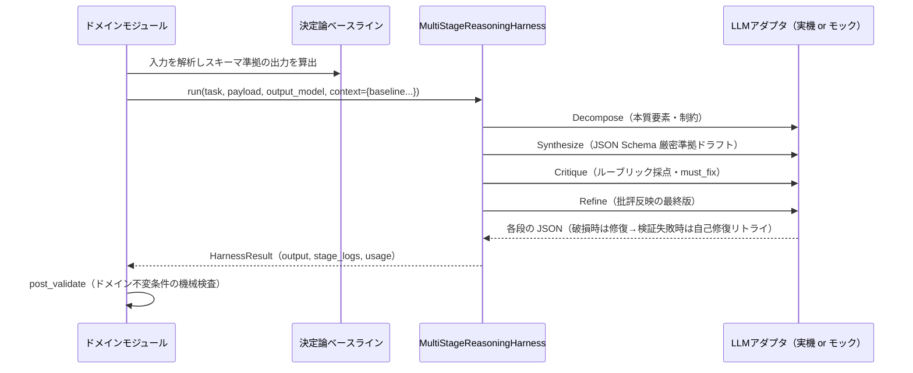
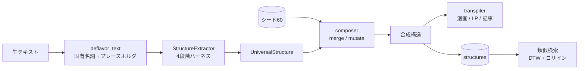
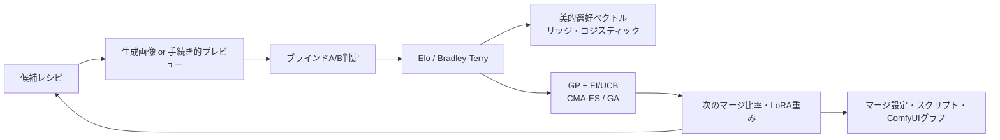
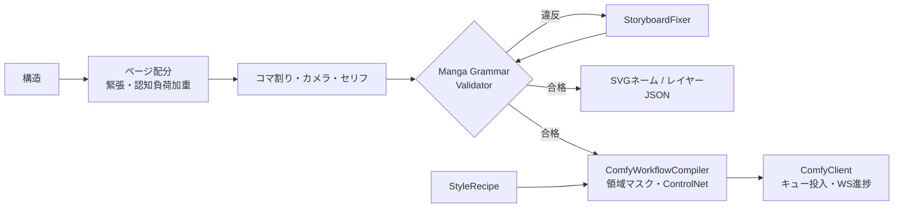
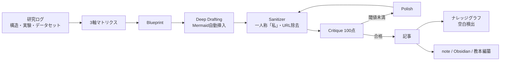

# Creative Asset Foundry — アーキテクチャ設計書

本書は CAF の構成要素・依存関係・データフロー・永続化・拡張点を定義する。要件とインターフェース契約の正本は [SPEC.md](../SPEC.md)、数理と運用の詳細は [MASTER_GUIDE.md](MASTER_GUIDE.md) を参照。

---

## 1. 全体像

### 1.1 層構成
| 層 | 責務 | 依存してよい先 |
|---|---|---|
| 共通基盤 `core/common.py` `core/config.py` `core/db.py` | ID・安定ハッシュ・設定・SQLite | 標準ライブラリ, pydantic |
| 推論基盤 `core/llm_client` | アダプタ・JSON修復・モック・テレメトリ・4段階ハーネス | 共通基盤, httpx |
| ドメイン `core/structure_engine` | 構造オントロジー（全ドメインの共通語彙） | 共通基盤, 推論基盤, numpy |
| ドメイン `core/style_alchemy` | 選好学習・最適化・データセット・ComfyUI モデルスタック | 共通基盤, 推論基盤, numpy |
| ドメイン `core/manga_pipeline` | ネーム・文法監査・ComfyUI 実行・SVG | 上記＋ structure_engine.schemas, style_alchemy.schemas/comfy_export |
| ドメイン `core/asset_publisher` | 資産化・サニタイズ・ナレッジグラフ | 上記＋ structure_engine.schemas |
| アプリケーション `web_studio/backend` | HTTP/WS 公開・ジョブ・設定永続化 | 全 core |
| プレゼンテーション `web_studio/frontend` | 5ワークスペース UI | backend API のみ |

依存は常に下向き。ドメイン間の結合は **スキーマ（Pydantic モデル）** のみで行い、実装モジュール同士は相互 import しない（`manga_pipeline` → `style_alchemy.comfy_export` のみ例外的に許可：ComfyUI モデルスタック構築を共有するため）。

---

## 2. 設計原則

### 2.1 Deterministic Core + LLM Amplification
LLM を使う全機能は、LLM なしで完全に動作する決定論的ベースラインを持つ。

- 実機 LLM 応答は `parse_json_lenient`（フェンス抽出・`<think>` 除去・構文修復）→ `model_validate` → 失敗時は検証エラーを添えた自己修復リトライ。
- モック LLM は `register_mock_handler(task, stages)` で登録されたタスク別ハンドラがベースラインからリアルな応答を合成し、未登録タスクは `JsonSchemaSynthesizer` が JSON Schema から決定論的に生成する。
- ハーネス失敗（`HarnessError`）時はベースラインへフォールバックし、機能は止まらない。

### 2.2 Dependency Injection
| 注入点 | 本番 | テスト |
|---|---|---|
| `BaseLLMAdapter` | `OpenAICompatibleAdapter` / `OllamaAdapter` / `AutoFallbackAdapter` | `MockLLMAdapter`（障害注入可） |
| httpx トランスポート | 実ネットワーク | `httpx.MockTransport` |
| ComfyUI | ローカル ComfyUI | `MockComfyServer`（実 uvicorn スレッド） |
| `Database` | `data/foundry.sqlite3` | `tmp_path` 配下の一時DB |

### 2.3 脱フレーバー保証とコンプライアンス保証
- 構造抽出は「抽出前の脱フレーバー（プレースホルダ化）」と「抽出後の全テキスト再走査（漏洩置換）」の二重防御。
- 記事出力は全経路の最終段で `ComplianceSanitizer` を通し、`find_urls()==[]` かつ `detect_first_person_variants()==[]` を機械検証する。

---

## 3. データモデルと永続化

| スキーマ名（`ensure_schema`） | 主なテーブル | 所有モジュール |
|---|---|---|
| `llm_telemetry` | `llm_calls`, `harness_runs`, `harness_stage_logs` | llm_client |
| `structure_engine` | `structures` | structure_engine.repository |
| `style_lab` | 候補・比較・観測・実験・セル・トークン・レシピ・データセットレポート | style_alchemy.repository |
| `manga_pipeline` / backend | ネーム（Storyboard JSON） | backend（manga ストア） |
| `asset_publisher` | 記事・マトリクス | asset_publisher.repository |
| backend | ジョブ履歴 | web_studio.backend |

- すべての複合データは Pydantic の `model_dump(mode="json")` を JSON 列に格納し、検索キー（カテゴリ・タイトル・ピーク位置等）のみ正規化列に持つ。
- 書き込みはプロセス内 RLock で直列化、読み取りは WAL により並行。バックアップは SQLite オンラインバックアップ API。

---

## 4. 主要データフロー

### 4.1 構造ループ（L1）

### 4.2 美学ループ（L2）

### 4.3 制作ループ（L3）

### 4.4 資産化ループ（L4）

---

## 5. Web Studio

### 5.1 バックエンド
- `create_app(settings, services)` がアプリファクトリ。`FoundryServices` がDB・LLMクライアント・各リポジトリ/エンジン・ジョブマネージャ・WSハブを保持する DI コンテナ。
- 設定更新（`PUT /api/system/config`）で `config.json` を永続化し、LLM クライアントを再構築する。
- 重い処理（抽出・ネーム生成・執筆・ComfyUI投入）は `async: true` 指定でジョブ化し、`/ws/progress` へ進捗イベントを配信する。既定は同期応答。
- ビルド済みフロントエンド（`web_studio/frontend/dist`）を同一オリジンで配信する。

### 5.2 フロントエンド
- 型付き API クライアント（`fetch` ラッパー）と WebSocket フックを共通基盤とし、5ワークスペースを左サイドバーで切替える。
- 可視化（波形エディタ・力学グラフ・選好ベクトル・共起ヒートマップ・タイムライン）は依存を増やさず SVG で自前描画する。
- 開発時は Vite が `/api` `/ws` をバックエンドへプロキシする。

---

## 6. テスト戦略

| レベル | ファイル | 内容 |
|---|---|---|
| 品質ゲート | `tests/test_quality_gates.py` | Zero Placeholder Policy の機械検査、全モジュール import 健全性 |
| 単体 | `tests/test_llm_client.py` ほか各 Phase | アルゴリズムの数値的性質（収束・回復・単調性・不変条件） |
| データ | `tests/test_seeds.py` | 60パターンの完全準拠・品質基準・波形の相互独立性・DB投入冪等性 |
| 結合 | `tests/test_backend_api.py` | 全REST・WebSocket エンドポイント |
| E2E | `tests/test_e2e_foundry.py` | 4ループを貫く一気通貫シナリオ |
| フロント | `npx tsc --noEmit` / `npm run build` | 型・ビルド |

---

## 7. 拡張点
- **新しいLLMバックエンド**: `BaseLLMAdapter` を実装し `factory.create_adapter` に登録。
- **新しいLLMタスク**: 決定論ベースライン＋`register_mock_handler` を追加し `MOCK_HANDLER_MODULES` に属するモジュールへ置く。
- **新しいモデルアーキテクチャ**: `ARCHITECTURE_BLOCKS` / `LBW_BLOCKS` / `ARCHITECTURE_PROFILES` と `comfy_merge_inputs` に追加。実機差異は `adapt_prompt_to_object_info` が吸収。
- **新しい構造変異・転用先**: `MutationType` / `TargetDomain` に追加し、決定論実装とテストを用意。
- **新しい漫画文法規則**: `MangaGrammarValidator` に rule を追加し、対応する修復演算子を `StoryboardFixer` に追加。
