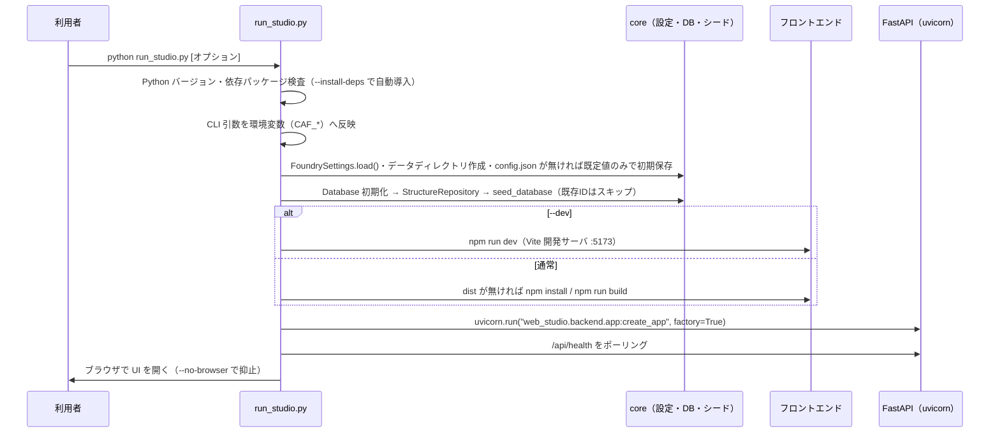
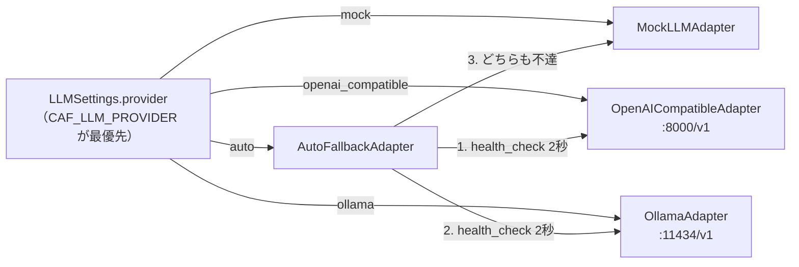
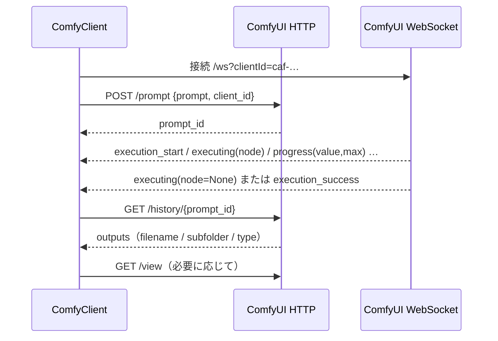
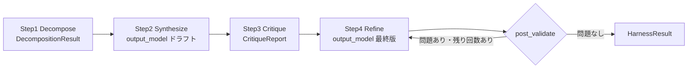
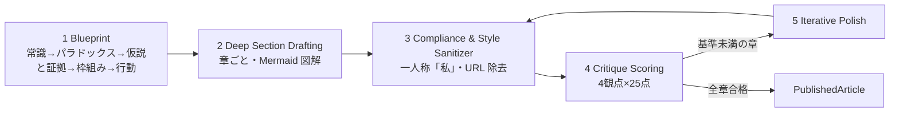
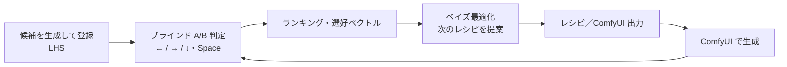

# Creative Asset Foundry — ローカル運用マスターガイド

本書は Creative Asset Foundry（CAF）をローカル環境で運用するための総合ガイドである。
起動方法、ローカル DeepSeek-V4.1-Flash と ComfyUI の接続手順、全アルゴリズムの数理、研究・制作・資産化の具体的な運用ワークフロー、API 概要、テストとトラブルシューティングをまとめる。

- 要件とモジュール間インターフェース契約の正本: [SPEC.md](../SPEC.md)
- 構成要素と依存関係・データフロー: [ARCHITECTURE.md](ARCHITECTURE.md)

---

## 目次

1. [概要とクイックスタート](#1-概要とクイックスタート)
2. [ローカル DeepSeek-V4.1-Flash の接続](#2-ローカル-deepseek-v41-flash-の接続)
3. [ComfyUI の接続](#3-comfyui-の接続)
4. [全アルゴリズムの数理解説](#4-全アルゴリズムの数理解説)
5. [運用ワークフロー](#5-運用ワークフロー)
6. [API リファレンス概要・テスト・トラブルシューティング](#6-api-リファレンス概要テストトラブルシューティング)

---

## 1. 概要とクイックスタート

### 1.1 4つの創作研究ループ

| ループ | 何を回すか | 主担当モジュール | Web Studio 画面 |
|---|---|---|---|
| L1 構造 | 生テキスト → 脱フレーバー抽出 → 構造代数（合成・変異）→ 漫画/LP/記事への転用 | `core/structure_engine` | Workspace 1 Structure Lab |
| L2 美学 | ブラインドA/B判定 → Elo/Bradley-Terry → 美的選好ベクトル → ベイズ最適化 → レシピ出力 | `core/style_alchemy` | Workspace 2 Style Alchemy Arena |
| L3 制作 | 構造 → ネーム（ページ割り・コマ割り・カメラ・台詞）→ 漫画文法監査 → SVG原稿・ComfyUI生成 | `core/manga_pipeline` | Workspace 3 Manga Studio |
| L4 資産化 | 研究ログ → 3軸企画 → 5段階執筆 → サニタイズ → ナレッジグラフ → 教本編纂 | `core/asset_publisher` | Workspace 4 Asset Publisher |

すべてのループは `core/llm_client`（多段階推論ハーネス）と SQLite（`core/db.py`）を共有する。LLM や ComfyUI が起動していなくても、決定論的ベースラインと高精度モックで全機能が動作する（Deterministic Core + LLM Amplification）。

### 1.2 動作要件

| 項目 | 要件 |
|---|---|
| Python | 3.10 以上（開発・検証は 3.13） |
| Python パッケージ | `pydantic>=2.6,<3`, `numpy>=1.26`, `httpx>=0.27`, `fastapi>=0.110`, `uvicorn[standard]>=0.29`, `websockets>=12` |
| テスト | `pytest>=8`, `pytest-asyncio>=0.23` |
| Node.js | 18 以上（UI のビルドに使用。無い場合は API のみで起動） |
| 任意 | ローカル LLM サーバ（OpenAI 互換 または Ollama）、ComfyUI |

### 1.3 インストール

リポジトリ直下で依存をインストールする。

```bash
pip install -e ".[dev]"
```

フロントエンドの依存インストールとビルドは `run_studio.py` が初回起動時に自動で行う（`web_studio/frontend/node_modules` と `dist` が無い場合のみ）。手動で行う場合は次のとおり。

```bash
cd web_studio/frontend
```

```bash
npm install
```

```bash
npm run build
```

### 1.4 起動

```bash
python run_studio.py
```

起動シーケンスは次のとおり。



既定ではブラウザで `http://127.0.0.1:8765` が開く。`--dev` 指定時は `http://127.0.0.1:5173`（Vite がホットリロードし、`/api` と `/ws` を `127.0.0.1:8765` へプロキシする）。

### 1.5 CLI オプション（`run_studio.py`）

| オプション | 既定値 | 説明 |
|---|---|---|
| `--host` | `127.0.0.1` | バックエンドの待受ホスト。`0.0.0.0` 指定時もブラウザは `127.0.0.1` を開く |
| `--port` | `8765` | バックエンドのポート |
| `--data-dir` | `./data` | データディレクトリ（`CAF_DATA_DIR` へ反映） |
| `--provider` | 設定値（既定 `auto`） | LLM プロバイダ `auto` / `mock` / `openai_compatible` / `ollama` |
| `--llm-url` | `http://localhost:8000/v1` | OpenAI 互換エンドポイント |
| `--ollama-url` | `http://localhost:11434/v1` | Ollama エンドポイント |
| `--model` | `DeepSeek-V4.1-Flash` | OpenAI 互換サーバ上のモデル名 |
| `--comfy-url` | `http://127.0.0.1:8188` | ComfyUI エンドポイント |
| `--comfy-mock` | 無効 | ComfyUI を内蔵モックサーバで代替 |
| `--dev` | 無効 | Vite 開発サーバを同時起動 |
| `--skip-frontend` | 無効 | UI のビルドを行わない |
| `--rebuild-frontend` | 無効 | `dist` があっても再ビルド |
| `--install-deps` | 無効 | 不足 Python パッケージを `pip install` で自動導入 |
| `--init-only` | 無効 | DB 初期化とシード投入だけ行って終了 |
| `--no-browser` | 無効 | ブラウザを自動で開かない |
| `--log-level` | `info` | uvicorn のログレベル（critical/error/warning/info/debug） |

DB 初期化とシード投入だけを行う例（`config.json` が無ければ既定値のみで作成される）:

```bash
python run_studio.py --init-only --data-dir ./data
```

LLM をモックに固定し、ComfyUI もモックで動かす例:

```bash
python run_studio.py --provider mock --comfy-mock
```

### 1.6 環境変数

設定の優先順位は **環境変数 > `<data_dir>/config.json` > 既定値**。`run_studio.py` の CLI 引数は環境変数へ変換されて反映される。CLI 引数・環境変数による上書きはその起動中だけの一時的なもので、`config.json` には書き込まれない（恒久的に変えたい値は System 画面で保存する）。

| 環境変数 | 対応する設定 | 説明 |
|---|---|---|
| `CAF_DATA_DIR` | `data_dir` | データディレクトリ（既定 `<repo>/data`） |
| `CAF_LLM_PROVIDER` | `llm.provider` | `auto` / `mock` / `openai_compatible` / `ollama`。LLM ファクトリでも最優先で参照される |
| `CAF_LLM_BASE_URL` | `llm.base_url` | OpenAI 互換エンドポイント |
| `CAF_OLLAMA_BASE_URL` | `llm.ollama_base_url` | Ollama エンドポイント |
| `CAF_LLM_MODEL` | `llm.model` | OpenAI 互換サーバ上のモデル名 |
| `CAF_LLM_API_KEY` | `llm.api_key` | API キー（ローカルサーバでは任意の文字列で可。既定 `EMPTY`） |
| `CAF_COMFY_URL` | `comfy.base_url` | ComfyUI エンドポイント |
| `CAF_COMFY_MOCK` | `comfy.use_mock` | `1/true/yes/on` で内蔵モック ComfyUI を使用 |

Ollama 側のモデル名（`llm.ollama_model`、既定 `deepseek-v4.1-flash`）、構造化出力モード、タイムアウト、ハーネス段階設定は System 画面または `config.json` で設定する。

### 1.7 データディレクトリ構成

```
data/
├── foundry.sqlite3        # 全永続データ（WAL モード。-wal / -shm ファイルが併存する）
├── config.json            # 初回起動時（--init-only を含む）に既定値のみで作成。以後は System 画面の保存で更新（data_dir 自体は含まない）
├── backups/               # バックアップ（foundry_YYYYmmdd_HHMMSS.sqlite3）
└── exports/               # エクスポート出力
```

`config.json` の例。初回起動時（`--init-only` を含む）、`config.json` が存在しなければ **既定値のみ** で作成される（`--provider` や `--llm-url`、`CAF_*` 環境変数による一時的な上書きは書き込まれない）。以後の値は System 画面での保存によって永続化される:

```json
{
  "llm": {
    "provider": "auto",
    "base_url": "http://localhost:8000/v1",
    "ollama_base_url": "http://localhost:11434/v1",
    "model": "DeepSeek-V4.1-Flash",
    "ollama_model": "deepseek-v4.1-flash",
    "api_key": "EMPTY",
    "timeout_s": 300.0,
    "temperature": 0.3,
    "max_tokens": 8192,
    "structured_output": "json_object",
    "mock_seed": 20260101,
    "harness": {
      "enable_decompose": true,
      "enable_critique": true,
      "enable_refine": true,
      "critique_accept_score": 85.0,
      "skip_refine_when_accepted": false,
      "max_repair_attempts": 3,
      "max_refine_rounds": 2,
      "stage_temperatures": {"decompose": 0.4, "synthesize": 0.3, "critique": 0.1, "refine": 0.2}
    }
  },
  "comfy": {
    "base_url": "http://127.0.0.1:8188",
    "timeout_s": 600.0,
    "client_id_prefix": "caf",
    "output_prefix": "caf",
    "use_mock": false
  }
}
```

主な SQLite テーブル（各モジュールが `Database.ensure_schema(name, ddl)` で冪等に作成する）:

| スキーマ名 | テーブル | 内容 |
|---|---|---|
| `llm_telemetry` | `llm_calls` / `harness_runs` / `harness_stage_logs` | LLM 呼び出しごとのトークン・レイテンシ・思考ログ、ハーネス実行と段ごとのログ |
| `structure_engine` | `structures` | 5階層構造（JSON 列）と検索用の正規化列（カテゴリ・タグ・ピーク位置・サスペンス/サプライズ係数） |
| `style_lab` | 候補・比較・観測・実験・セル・トークン・レシピ・データセットレポート | Style Alchemy の全実験台帳 |
| `asset_publisher` | 記事・マトリクス | 生成記事と3軸企画 |
| バックエンド | ネーム・ジョブ | Storyboard JSON とジョブ履歴 |

### 1.8 バックアップと復元

**バックアップ**: System 画面の「バックアップ」ボタン、または API で作成する。SQLite のオンラインバックアップ API を用いるため、稼働中でも整合性のあるスナップショットが得られる。

```bash
curl -X POST http://127.0.0.1:8765/api/system/db/backup
```

`data/backups/foundry_YYYYmmdd_HHMMSS.sqlite3` が作成される。一覧は `GET /api/system/db/backups`。

`config.json` は DB バックアップに含まれないため、設定も保全したい場合は `data/config.json` を別途コピーしておく。

**復元**: サーバを停止してから、`data/foundry.sqlite3` とその `-wal` / `-shm` を退避し、バックアップファイルを `data/foundry.sqlite3` としてコピーして再起動する（WAL ファイルを残したまま差し替えると不整合の原因になる）。

```bash
cp data/backups/foundry_20261103_120000.sqlite3 data/foundry.sqlite3
```

---

## 2. ローカル DeepSeek-V4.1-Flash の接続

### 2.1 接続方式の全体像

`core/llm_client` は OpenAI 互換 API と Ollama API の双方に対応する非同期クライアントである。プロバイダの選択は次のとおり。



いずれのアダプタも `LLMClient` に包まれ、構造化生成（スキーマ指示の付与 → JSON 抽出・修復 → Pydantic 検証 → 自己修復リトライ）とテレメトリ記録が共通に適用される。

### 2.2 OpenAI 互換サーバ（ポート 8000 / `/v1`）

CAF が使う API は次の2つだけである。

| API | 用途 |
|---|---|
| `POST {base_url}/chat/completions` | 推論本体（`stream: false`） |
| `GET {base_url}/models` | 接続テスト・モデル一覧 |

接続条件:

1. サーバが `http://localhost:8000/v1` で待ち受けていること（別ポートなら `--llm-url` か System 画面で変更）。
2. サーバ上のモデル名（served model name）が `llm.model`（既定 `DeepSeek-V4.1-Flash`）と一致すること。接続テストは `/v1/models` の一覧にこの名前が含まれるかも確認する。
3. API キーを要求しないサーバでは `api_key` は任意の文字列でよい（既定 `EMPTY`。`Authorization: Bearer <api_key>` ヘッダとして送られる）。

各推論サーバでの起動は次のような形になる。**以下はいずれも例であり、モデルの配布名・ローカルパス・量子化形式・フラグ名は利用するサーバのバージョンと配布形態に合わせて置き換えること。**

vLLM の例:

```bash
vllm serve <モデルのローカルパスまたは配布名> --served-model-name DeepSeek-V4.1-Flash --port 8000
```

SGLang の例:

```bash
python -m sglang.launch_server --model-path <モデルのローカルパス> --served-model-name DeepSeek-V4.1-Flash --port 8000
```

llama.cpp server の例（GGUF 形式）:

```bash
llama-server -m <GGUFファイルのパス> --alias DeepSeek-V4.1-Flash --port 8000
```

LM Studio の場合は GUI の「Local Server」でモデルを読み込み、ポートを 8000 に設定するか、CAF 側の `base_url` を LM Studio のポートに合わせる。いずれの場合もサーバの思考（reasoning）分離機能があれば有効にしておくと、思考ログが `reasoning_content` として分離され、本文の JSON 抽出が安定する。

### 2.3 構造化出力モード（`structured_output`）

| モード | 送信される `response_format` | 選ぶ基準 |
|---|---|---|
| `json_schema` | `{"type":"json_schema","json_schema":{"name":<スキーマ名>,"schema":<JSON Schema>,"strict":false}}` | サーバが JSON Schema によるガイド付きデコードに対応している場合。構文崩れが最も少ない。巨大スキーマ（構造抽出の `StructureLayers` 等）で生成が遅くなるサーバでは `json_object` を選ぶ |
| `json_object`（既定） | `{"type":"json_object"}` | 多くのサーバが対応する JSON モード。スキーマの遵守はプロンプト指示＋検証＋自己修復で担保する |
| `prompt_only` | 送らない | `response_format` を受け付けない／無視するサーバ。プロンプト指示と修復パイプラインのみで運用する |

どのモードでも、`LLMClient.generate_structured` は system プロンプト末尾にスキーマ指示（minify した JSON Schema・JSON のみ出力・必須項目・数値範囲・コメント禁止・URL 禁止）を追記する。応答は次の順で解釈される。

1. `json.loads` で直接解析
2. ```json フェンスまたは最初のバランスした `{…}` / `[…]` を抽出
3. 文字単位スキャナによる構文修復（§4.1.3）
4. Pydantic `model_validate`
5. 失敗時は「失敗した出力（最大6000字）＋検証エラー一覧（最大20件）」を会話に追記して再生成（自己修復リトライ、`max_repair_attempts` 回まで）

### 2.4 思考ログ（`reasoning_content` と `<think>`）

- 応答 `message.reasoning_content`（または `message.reasoning`）を思考ログとして取得する。
- 本文 `content` に `<think>…</think>`（`<thinking>` 表記、未閉鎖、先頭の閉じタグのみ、を含む）が混入した場合は本文から除去して思考ログへ移す。
- 推論トークン数は `usage.completion_tokens_details.reasoning_tokens`（または `usage.reasoning_tokens`）を採用し、無ければ思考ログ文字列から推定する（推定値は `estimated=True`）。`TokenUsage.total_tokens` は prompt + completion で、reasoning は completion の内訳として扱う（OpenAI 互換の慣行）。
- テレメトリには要求・応答の抜粋を各4,000字、思考ログを20,000字まで保存する。System 画面のテレメトリ表で確認できる。

### 2.5 タイムアウト・トークン上限・コンテキスト長の目安

| 設定 | 既定 | 目安 |
|---|---|---|
| `timeout_s` | 300 秒 | 長文抽出や Critique で出力が長くなるため、低速 GPU では 600 秒程度へ延長する |
| `max_tokens` | 8192 | 構造化生成の既定上限。構造抽出（`StructureLayers`）は 21点×5チャネルの波形・ビート・メカニズムを含むため 4,000〜8,000 トークンの出力になり得る |
| トランスポート再試行 | 2 回 | 429 / 5xx / 通信断は $0.5 \cdot 2^k$ 秒（0.5 秒, 1 秒）待って再試行。429 以外の 4xx は即時エラー |

コンテキスト長は、スキーマ指示（構造抽出では JSON Schema だけで約 14KB、和文換算でおおむね 4〜5 千トークン）＋入力本文＋修復時の追記を収める必要がある。**32K トークン以上を推奨**、長いあらすじやネーム全体を扱う場合は 64K 以上が望ましい。

### 2.6 Ollama（ポート 11434 / `/v1`）

- `ollama_base_url`（既定 `http://localhost:11434/v1`）の OpenAI 互換エンドポイントに `ollama_model`（既定 `deepseek-v4.1-flash`）で接続する。
- **モデル名は `ollama list` に表示されるタグと完全一致させる**（配布形態によりタグ名は異なるため、既定値は自分の環境のタグへ置き換える）。
- 接続テストはネイティブ `GET /api/tags`（ルート URL は `/v1` を除いたもの）を優先し、失敗時は `/v1/models` で確認する。

モデルの取得と起動は次のような形になる（例。タグは利用する配布に合わせる）。

```bash
ollama pull <モデルタグ>
```

```bash
ollama serve
```

### 2.7 `auto` フォールバックの挙動

`AutoFallbackAdapter` は **最初のリクエスト時** に OpenAI 互換 → Ollama の順に `health_check` を 2 秒のタイムアウトで実行し、最初に成功したアダプタを採用してキャッシュする。どちらも不達ならモックを採用し `fallback_active=True` となる。採用済みの実機アダプタが後で `LLMConnectionError` を出した場合は、モックへ切り替えて同じリクエストを再実行する（処理は止まらない）。

- フォールバック状態は `GET /api/health` の `llm_provider` / `llm_fallback_active` と System 画面に表示される。
- 実機サーバを後から起動した場合は、System 画面で設定を保存し直す（LLM クライアントが再構築され、次のリクエストで再探索される）か、スタジオを再起動する。
- テスト・CI では `CAF_LLM_PROVIDER=mock` を設定して完全に決定論的に動かす（`tests/conftest.py` が強制している）。

### 2.8 System 画面での設定と接続テスト

サイドバーの「System & Local AI」（Workspace 5、URL ハッシュ `#system`）で次を行う。画面上部のステータスバーには常に `LLM`（実効プロバイダ・モデル名。フォールバック中は「モックへフォールバック中」バッジ）、`ComfyUI`（接続先 URL または「内蔵モック」）、`構造DB`（件数とシード件数）、WebSocket 接続状態（「WebSocket 接続中」／「WebSocket 再接続中」）と「更新」ボタンが表示される。

1. **「ローカル LLM（DeepSeek-V4.1-Flash）」カード**: 「プロバイダ」「OpenAI 互換エンドポイント URL」「モデル名（OpenAI 互換）」「Ollama エンドポイント URL」「モデル名（Ollama）」「API キー」「構造化出力モード」「最大トークン数」「タイムアウト（秒）」「既定 temperature」を入力して「保存」（`PUT /api/system/config`）。保存すると LLM クライアントが再構築される。API キーはマスク表示され、マスク表示のまま保存すると既存のキーが保持される。
2. 同カードの「接続テスト」（`POST /api/system/llm/test`）で到達性・モデル一覧・所要時間を確認する。auto でモックに切り替わっている場合は「フォールバック中」バッジが付く。
3. **「思考段階設定（Multi-Stage Reasoning Harness）」**: 「Step 1 Decompose」「Step 2 Synthesize（常時）」「Step 3 Critique」「Step 4 Refine」の ON/OFF、「合格時は Refine を省略」、「批評の合格基準点」「自己修復リトライ回数」「追加精錬ラウンド上限」を設定して「保存」（意味は次節 2.9。段ごとの temperature は `config.json` の `stage_temperatures` で調整する）。
4. **「ComfyUI」カード**: 「エンドポイント URL」「出力ファイル接頭辞」と「内蔵モック ComfyUI を使う（実機なしで投入・進捗監視を検証）」を設定し、「接続テスト」（`POST /api/system/comfy/test`）と「保存」。
5. **「SQLite データベース」**: 「ファイルサイズ（WAL 含む）」「テーブル数」とテーブル別件数を「更新」で再取得、「バックアップ作成」（`POST /api/system/db/backup`）とバックアップ一覧（`GET /api/system/db/backups`）。
6. **「初期シード（普遍的構造データベース）」**: 「シード構造数」を確認し、「未投入分を投入」（既存IDはスキップ）または「上書き再投入」（`POST /api/seeds/load`）。
7. **「推論テレメトリ」**: 「呼び出し」「成功率」「入力トークン」「出力トークン」「思考トークン」「平均レイテンシ」の集計、「タスク×段階別統計」（例 `structure.extract` × decompose/synthesize/critique/refine）、呼び出し履歴（時刻・タスク・段階・試行・結果・入力/出力/思考・レイテンシ）、「ハーネス実行履歴」（開始・タスク・状態・批評スコア・合計レイテンシ）。構造化生成が失敗した呼び出しは結果列で識別でき、検証エラーと思考ログの確認に使う。

### 2.9 思考段階設定（4段階ハーネス）

| 設定 | 既定 | 効果 | トレードオフ |
|---|---|---|---|
| `enable_decompose` | true | Step1 で課題の本質要素・制約・成功条件を分解し、Synthesize の指針にする | 1 呼び出し増。短い定型タスクでは OFF にしても品質低下は小さい |
| `enable_critique` | true | Step3 でルーブリック（論理的一貫性・構造の深さ・抽象化の質・スキーマ忠実度・実用性）採点と must_fix を得る | 1 呼び出し増。OFF にすると Refine は批評なしの自己推敲になる |
| `enable_refine` | true | Step4 で批評を反映した最終版を生成 | 1 呼び出し増。OFF にするとドラフトが最終出力 |
| `critique_accept_score` | 85.0 | 批評の総合点がこの値以上で verdict=accept | 高くするほど Refine の推敲が厳しくなる |
| `skip_refine_when_accepted` | false | accept 時に Refine を省略 | 速度優先。true にすると良好な案件で 1 呼び出し削減 |
| `max_repair_attempts` | 3 | 構造化出力の自己修復リトライ回数（総試行は +1） | 小さいとスキーマ違反時に早く失敗（ベースラインへフォールバック）、大きいとトークンを消費 |
| `max_refine_rounds` | 2 | ドメイン検証（`post_validate`）で問題が残った場合の追加 Refine 回数 | 構造抽出では固有名詞の漏洩・整合性エラーの是正に使われる |
| `stage_temperatures` | decompose 0.4 / synthesize 0.3 / critique 0.1 / refine 0.2 | 段ごとのサンプリング温度 | 批評は低温で安定、分解はやや高温で網羅的に |

1 回のハーネス実行の呼び出し数は

$$
N_{\text{calls}} = [\text{decompose}] + (1 + r_s) + [\text{critique}] + [\text{refine}]\,(1 + r_r) + n_{\text{extra}}
$$

（$r_s, r_r$ は各段の修復回数、$n_{\text{extra}} \le$ `max_refine_rounds`）である。段の失敗方針は次のとおり: Decompose/Critique の失敗は警告を残して続行、Synthesize の失敗は `HarnessError`（呼び出し側は決定論的ベースラインへフォールバック）、Refine の失敗は直前の版を採用。

---

## 3. ComfyUI の接続

### 3.1 前提と使用 API

ComfyUI を既定ポート 8188 で起動しておく（別ホスト・別ポートなら `--comfy-url` または System 画面で指定）。CAF が使う API は次のとおり。

| API | 用途 |
|---|---|
| `POST /prompt` | ワークフロー（API 形式）のキュー投入。本文 `{"prompt": {...}, "client_id": "<id>"}` → `prompt_id` |
| `GET /history/{prompt_id}` | 実行結果（出力画像のファイル名・サブフォルダ・種別） |
| `GET /view?filename=…&subfolder=…&type=output` | 生成画像の取得 |
| `GET /object_info` / `GET /object_info/{class}` | 導入済みノードと入力名の取得（入力名の適合に使用） |
| `GET /system_stats` | 接続テスト |
| `POST /interrupt` | 実行中断 |
| `WS /ws?clientId=<id>` | 進捗イベント（status / execution_start / executing / progress / executed / execution_success / execution_error / execution_interrupted） |



WebSocket が確立できない、または途中で切断された場合、`ComfyClient` は `/history` のポーリングに切り替えて完了を待つ。タイムアウトは `comfy.timeout_s`（既定 600 秒）。

### 3.2 使用ノード

| 区分 | ノード | 用途 |
|---|---|---|
| 標準 | `CheckpointLoaderSimple` | SDXL / SD1.5 のモデル読込（MODEL/CLIP/VAE） |
| 標準 | `UNETLoader`, `DualCLIPLoader`, `CLIPLoader`, `VAELoader` | FLUX / ANIMA 等の分割配布モデル読込 |
| 標準 | `ModelMergeSDXL`, `ModelMergeSD1`, `ModelMergeFlux1` | 階層別ブロックマージ |
| 標準 | `ModelMergeSimple` | 階層別ノードが無い場合の代替（比率平均） |
| 標準 | `ModelMergeSubtract`, `ModelMergeAdd`, `CLIPMergeSubtract`, `CLIPMergeAdd` | 差分加算マージ $A + (B - C)$ |
| 標準 | `CLIPMergeSimple` | テキストエンコーダ（BASE）のマージ |
| 標準 | `LoraLoader` | LoRA の一様強度適用 |
| 標準 | `CLIPSetLastLayer` | CLIP Skip |
| 標準 | `CLIPTextEncode`, `FluxGuidance` | 条件付け |
| 標準 | `SolidMask`, `MaskComposite`, `FeatherMask`, `ConditioningSetMask`, `ConditioningCombine` | 複数人物の領域分割（Attention Couple 相当） |
| 標準 | `LoadImage`, `ControlNetLoader`, `ControlNetApplyAdvanced` | ControlNet（OpenPose / Lineart / Depth） |
| 標準 | `EmptyLatentImage`, `EmptySD3LatentImage`, `KSampler`, `VAEDecode`, `SaveImage` | 生成と保存 |
| 任意 | `LoraLoaderBlockWeight //Inspire`（ComfyUI-Inspire-Pack） | LoRA Block Weight（階層ウェイト）適用 |
| 任意 | `ModelMergeCosmosPredict2_2B` | ANIMA プロファイルの階層別マージ（導入済みの場合） |

### 3.3 マージ比率の変換

ComfyUI の `ModelMerge*` 系ノードの比率 `ratio` は **model1 の重み**（`ratio=1.0` で純 model1）である。一方、CAF の `BlockMergeRecipe.block_weights` は **model_b の比率** $w_b$（0=純A, 1=純B）なので、エクスポート時に

$$
\text{ratio}_{\text{ComfyUI}} = 1 - w_b
$$

へ変換する。正準ブロック名と ComfyUI 入力名の対応:

| アーキテクチャ | 正準ブロック | ComfyUI ノード・入力名 |
|---|---|---|
| SDXL | BASE, IN00..IN08, MID, OUT00..OUT08 | `ModelMergeSDXL`: `time_embed.` `label_emb.` `out.`（←BASE）, `input_blocks.{i}`, `middle_block.{0,1,2}`（←MID）, `output_blocks.{i}` |
| SD1.5 | BASE, IN00..IN11, MID, OUT00..OUT11 | `ModelMergeSD1`: `time_embed.` `label_emb.` `out.`（←BASE）, `input_blocks.{i}.`, `middle_block.{0,1,2}.`, `output_blocks.{i}.` |
| FLUX | BASE, DB00..DB18, SB00..SB37 | `ModelMergeFlux1`: `img_in.` `time_in.` `guidance_in` `vector_in.` `txt_in.` `final_layer.`（←BASE）, `double_blocks.{i}.`, `single_blocks.{i}.` |
| ANIMA | BASE, B00..B27 | `ModelMergeCosmosPredict2_2B`: `pos_embedder.` `x_embedder.` `t_embedder.` `t_embedding_norm.` `final_layer.`（←BASE）, `blocks.{i}.` |

BASE の比率はテキストエンコーダにも `CLIPMergeSimple(ratio=1-w_BASE)` で適用される（$w_{\text{BASE}}>0$ の場合のみ）。差分加算（`add_difference`）は `ModelMergeSubtract(B, C)` → `ModelMergeAdd(A, ·)` で $A+(B-C)$ を作り、それを model2 として階層マージに渡すため、ブロック $b$ の重みは

$$
\theta_b = (1-w_b)\,\theta^A_b + w_b\,(\theta^A_b + \theta^B_b - \theta^C_b) = \theta^A_b + w_b(\theta^B_b - \theta^C_b)
$$

となる。

### 3.4 実機への入力名適合（`adapt_prompt_to_object_info`）

ComfyUI のバージョンによってノードの入力名（末尾ドットの有無）が異なり得る。CAF は接続先の `/object_info` を取得し、

1. 入力名を「末尾ドットを除いた名前」で正規化照合して実機の入力名へ改名する。
2. 実機に存在しないアーキテクチャ別マージノード（`ModelMergeSDXL` 等）は、全ブロック比率の平均を `ratio` とする `ModelMergeSimple` に自動置換する（精密な階層マージは §4.8.8 のマージスクリプトで行える）。
3. その他の未導入ノード（例: Inspire Pack 未導入時の LBW ノード）は警告として報告する（導入が必要）。

### 3.5 ANIMA プロファイルの前提と調整

ANIMA は「Cosmos-Predict2 2B 系の汎用 DiT（28 ブロック）」を想定した汎用プロファイルである。チェックポイントの配布形態はモデルごとに異なるため、次をレシピ（`StyleRecipe`）で調整する。

| 項目 | 既定 | 調整方法 |
|---|---|---|
| ローダー | `UNETLoader`（拡散モデル単体） | — |
| テキストエンコーダ | `CLIPLoader`、ファイル `text_encoder.safetensors`、type `stable_diffusion` | `StyleRecipe.text_encoders`（ファイル名）、`StyleRecipe.text_encoder_type`（`CLIPLoader` の type） |
| VAE | `vae.safetensors` | `StyleRecipe.vae` |
| 潜在ノード | `EmptyLatentImage` | `ARCHITECTURE_PROFILES[ANIMA]["latent_node"]` |
| 階層マージノード | `ModelMergeCosmosPredict2_2B`（未導入なら `ModelMergeSimple` へ自動置換） | `ARCHITECTURE_PROFILES[ANIMA]["merge_node"]` |
| ブロック深さ | 28（B00..B27） | 深さが異なる場合は `ARCHITECTURE_BLOCKS[ANIMA]` を読み替える |

FLUX プロファイルは `DualCLIPLoader`（type `flux`、既定 `clip_l.safetensors` + `t5xxl_fp16.safetensors`）、VAE `ae.safetensors`、潜在 `EmptySD3LatentImage`、`FluxGuidance`（cfg が 1.5 以下なら guidance 3.5）を使い、KSampler の cfg は 1.0 に固定する。

### 3.6 LoRA Block Weight

LoRA に非一様な `block_weights` がある場合、`LoraLoaderBlockWeight //Inspire` ノードで `block_vector` に階層ウェイトを渡す（未指定ブロックは 1.0）。ベクトルの並びは慣行的な評価点に従う。

| アーキテクチャ | 点数 | 並び |
|---|---|---|
| SDXL | 12 | BASE, IN04, IN05, IN07, IN08, MID, OUT00..OUT05 |
| SD1.5 | 17 | BASE, IN01, IN02, IN04, IN05, IN07, IN08, MID, OUT03..OUT11 |
| FLUX | 58 | BASE, DB00..DB18, SB00..SB37 |
| ANIMA | 29 | BASE, B00..B27 |

一様な LoRA は標準の `LoraLoader(strength_model, strength_clip)` を使う。

### 3.7 ControlNet

- モデルは ComfyUI の `models/controlnet/` に置く。既定のファイル名は `controlnet_openpose_sdxl.safetensors` / `controlnet_lineart_sdxl.safetensors` / `controlnet_depth_sdxl.safetensors`（`CompilerConfig.controlnet_models` で変更）。
- ガイド画像（ポーズ骨格・線画・深度）は ComfyUI の `input/` フォルダに置き、`ControlGuide.image_name` でファイル名を指定する。
- `ControlGuide` の既定: `strength=0.8`, `start_percent=0.0`, `end_percent=0.85`。複数ガイドは `ControlNetApplyAdvanced` を positive / negative の両方へ連鎖させる。

### 3.8 出力ファイルとシード

- コマごとのワークフローは `SaveImage(filename_prefix="{CompilerConfig.filename_prefix}/{storyboard_id}/p{ページ:02d}_k{コマ:02d}")`（既定の接頭辞 `caf`、ページ・コマ番号は 0 始まり）で保存される。
- シードは `SeedManager` がネームのシードとコマ ID から安定ハッシュで導出し（実行ごとに同じ値）、気に入ったコマは固定（lock）できる。

### 3.9 モックモード

`--comfy-mock`、`CAF_COMFY_MOCK=1`、または System 画面の `use_mock` で、内蔵の `MockComfyServer`（FastAPI + uvicorn を空きポートでスレッド起動）が ComfyUI の代わりに応答する。キュー投入時にグラフを検証し、トポロジカル順の `executing`、KSampler の steps 回の `progress`、SaveImage での小さな PNG 生成、`/history` 保存、`/view` 配信までを本物と同じプロトコルで模擬するため、ComfyUI 未導入でもワークフロー投入から進捗監視までの全経路を確認できる。

---

## 4. 全アルゴリズムの数理解説

### 4.1 推論基盤（`core/llm_client`）

#### 4.1.1 4段階思考増幅ハーネス

`MultiStageReasoningHarness.run(task, objective, payload, output_model, system_prompt, rubric, context, post_validate)` は次の4段を実行する。



| 段 | 出力スキーマ | モック／ハンドラへ渡す context |
|---|---|---|
| Decompose | `DecompositionResult`（essence, core_elements, constraints, hidden_assumptions, success_criteria, abstraction_targets, risks） | `objective`, `payload` |
| Synthesize | `output_model` | ＋ `decomposition` |
| Critique | `CritiqueReport`（scores[key, 0〜10], logical_contradictions, shallow_points, abstraction_gaps, must_fix, overall_score 0〜100, verdict） | ＋ `draft`, `rubric`, `accept_score` |
| Refine | `output_model` | ＋ `draft`, `critique`, `must_fix` |

全段の system プロンプトは DeepSeek 向けペルソナ（`DEEPSEEK_BASE_PERSONA`）＋タスク固有のシステムプロンプトで構成される。既定ルーブリックは logical_consistency（重み1.2）・structural_depth（1.2）・abstraction_quality（1.0）・schema_fidelity（1.0）・actionability（0.8）。総合点は

$$
\text{overall} = 10 \cdot \frac{\sum_k w_k s_k}{\sum_k w_k}, \qquad s_k \in [0, 10]
$$

で、`overall ≥ critique_accept_score` かつ論理矛盾なしで accept となる。`post_validate`（ドメイン不変条件の機械検査）が問題を返した場合、`max_refine_rounds` まで must_fix に問題を注入した追加 Refine を行う。

#### 4.1.2 自己修復リトライ

総試行回数 $1 + $ `max_repair_attempts`。$k$ 回目の失敗時、会話に「失敗出力（assistant）」と「検証エラーの箇条書き＋スキーマ名を添えた修復指示（user）」を追記して同じ段で再生成する。context には `repair=True`, `previous_errors`, `original_stage` が入る。全試行が失敗すると `StructuredOutputError`（生テキスト・検証エラー・試行回数・累計トークン・累計レイテンシ）を送出する。全試行はテレメトリに試行番号付きで記録される。

#### 4.1.3 JSON 修復

ローカル LLM の崩れ方を文字単位スキャナで決定論的に修復する。

1. **思考除去**: `<think>…</think>`（未閉鎖・閉じタグのみも含む）を除去し思考ログへ分離。
2. **抽出**: ```json フェンス、または最初のバランスした `{…}` / `[…]`（文字列内の括弧・バッククォートを無視）を候補とし、`json.loads` が通る候補を優先する。
3. **字句正規化（パス1）**: スマートクォート → ASCII、`//`・`/* */`・`#` コメント除去、Python/JS リテラル（True/False/None/undefined/NaN/Infinity）の変換、単引用文字列 → 二重引用、未引用キー → 引用、裸の単語値 → 文字列、文字列内の生改行・タブ・制御文字のエスケープ、文字列内の未エスケープ `"`（直後の非空白が `,:}]` 以外で改行を挟まなければ内側の引用とみなしてエスケープ）、非準拠数値（`+1`, `.5`, `1.`, `007`）の正規化。
4. **構造修復（パス2）**: トークン列を状態機械で辿り、末尾カンマ除去、改行を挟んだ値間の欠落カンマ・欠落コロンの挿入、途中切断の補完（開いた文字列のクローズ、ぶら下がりキーへの `null` 補完、括弧のクローズ）、不一致・過剰な閉じ括弧の整理を行う。

修復を要したかどうかは `StructuredResult.syntax_repaired` に記録される。

#### 4.1.4 高精度モックと JSON Schema 合成器

- タスク別ハンドラの解決順: `(task, stage)` → Decompose/Critique は `("*", stage)` → `(task, "*")`、その他の段は `(task, "*")` → `("*", stage)` → 汎用合成器。各モジュールの `mock_handlers.py`（`core.structure_engine` / `core.style_alchemy` / `core.manga_pipeline` / `core.asset_publisher`）は初回呼び出し時に遅延 import される。
- 乱数シード: $\text{seed} = \text{stable\_seed}(\text{seed}_0, \text{task}, \text{stage}, \text{schema\_name}, \text{attempt}, \text{SHA256(全メッセージ)})$。同一要求には常に同一応答。
- `JsonSchemaSynthesizer` は Pydantic v2 の `model_json_schema()` 出力（`$defs`/`$ref`、`anyOf`/`oneOf`/`allOf`、`enum`/`const`/`default`、数値・長さ・要素数制約、`multipleOf`、`pattern`、`format`）を満たすインスタンスを生成する。プロパティ名ヒューリスティック（title / description / tags / score 等）で日本語のリアルな値を作り、URL は生成しない。
- 既定 Critique ハンドラはドラフトを実際に解析（空文字・短文・重複・数値範囲・リスト長）してルーブリック各項目を採点する。
- 障害注入 `failure_plan`: `ok` / `garbage`（JSON なし）/ `schema_violation` / `repairable_json` / `connection_error` / `empty` を呼び出しごとに消費し、自己修復経路をテストで再現する。

#### 4.1.5 トークン推定

サーバが `usage` を返さない場合、

$$
\hat{n} = \left\lceil n_{\text{CJK}} + \frac{n_{\text{ASCII}}}{4} + \frac{n_{\text{other}}}{2} \right\rceil
$$

（CJK = 漢字・かな・ハングル・全角記号）で推定し、メッセージごとに 4 トークン、返信開始に 2 トークンのオーバーヘッドを加える。

### 4.2 普遍的構造オントロジーと波形指標

5階層:

| 層 | スキーマ | 内容 |
|---|---|---|
| L1 | `DynamicTensionGraph` | ノード（agent 主体 / desire 欲求 / lack 欠落 / symbol 象徴）と有向エッジ（opposition 対立 / dependency 依存 / asymmetry 非対称性 / power_gradient 権力勾配 / betrayal 裏切り / pursuit 追求 / embodiment 体現）。エッジは強度 $I\in[0,1]$、勾配 $G\in[-1,1]$（正 = source 優位）、顕在化時刻 `activation_t` |
| L2 | `EmotionalInformationWave` | 正規化時間 $t\in[0,1]$ 上の 21 点以上（20 分割以上）の緊張度 $T$・解放度 $R$・読者認知量 $a$・作中人物認知量 $c$・認知負荷 $L$ |
| L3 | `StructuralBeatChain` | フック〜余韻のビート列（$t$ 非減少）と因果 DAG（`causes` は先行ビートのみ） |
| L4 | `CognitiveEmpathyMechanics` | 20 分類の認知・共感メカニズム（情報ギャップ、劇的アイロニー、予測誤差、損失回避 等） |
| L5 | `DomainAgnosticBlueprint` | `{{SLOT}}` 抽象変数を持つテンプレートと不変条件 |

**情報非対称性**（派生チャネル、常に整合的に計算される）:

$$
A(t) = a(t) - c(t) \in [-1, 1]
$$

正は「読者だけが知る」（サスペンス・劇的アイロニー）、負は「作中人物や語りが秘匿」（ミステリー・サプライズの溜め）。

**サスペンス係数**:

$$
S_{\text{susp}} = \frac{1}{N}\sum_{i} \max(A_i, 0)\, T_i
$$

**サプライズ係数**（最大の一挙開示を直前の秘匿で増幅）:

$$
S_{\text{surp}} = \operatorname{clip}\!\left(2 \max_i \Big[\max(a_{i+1}-a_i, 0)\,\big(0.5 + 0.5\max(-A_i, 0)\big)\Big],\ 0,\ 1\right)
$$

**カタルシス指数**（緊張の下降量 × 直後の解放度）:

$$
K = \operatorname{clip}\!\left(\frac{\sum_i \max(T_i - T_{i+1}, 0)\, R_{i+1}}{\max_i T_i},\ 0,\ 1\right)
$$

**力学的緊張エネルギー**: 種別係数 $\omega$（裏切り 1.2、対立 1.0、権力勾配 0.8、非対称性 0.6、追求 0.4、依存 0.3、体現 0.1）を用いて

$$
E = \sum_{e \in \text{勾配系}} \omega_e I_e \left(0.5 + 0.5|G_e|\right) + \sum_{e \notin \text{勾配系}} \omega_e I_e
$$

**権力収支**: 権力勾配・非対称性エッジについて、ノード $v$ の正味優位 $P_v = \sum_{e: s=v} G_e I_e - \sum_{e: t=v} G_e I_e$。

**PCHIP（波形の著作補間）**: シード著作では各チャネルを 6〜12 キーフレームで設計し、Fritsch–Carlson 法の区分 3 次エルミート補間で 21 点へ展開する（オーバーシュートしないため [0,1] を守る）。内部節点の傾きは

$$
d_k = \begin{cases} 0 & \delta_{k-1}\delta_k \le 0 \\ \dfrac{w_1 + w_2}{w_1/\delta_{k-1} + w_2/\delta_k} & \text{otherwise} \end{cases},\quad w_1 = 2h_k + h_{k-1},\ w_2 = h_k + 2h_{k-1}
$$

（$\delta_k$ は区間の差分商、$h_k$ は区間幅）で、端点は形状保存の 3 点推定を用いる。

### 4.3 脱フレーバー抽出とヒューリスティック逆コンパイル

**固有名詞の検出**（`deflavor_text`）: カタカナ語（2 文字以上、一般外来語辞書に無いもの）、敬称（さん/くん/様/殿/先生/氏 等）直前の名、主要な姓＋名、「」『』内の短い名称、地名接尾辞（市/町/村/国/王国/帝国/学園/高校/大学/島/山/城/都 等）・組織接尾辞（社/団/隊/党/ギルド/騎士団/研究所/財団/商会 等）、英語の文中大文字始まり語（連続は結合）。重複しない候補を選び、出現順に `[人物A]` `[人物B]` `[場所A]` `[組織A]` `[固有物A]` `[作品A]` 等へ置換する。多語・中黒区切りの名前は構成要素も同じプレースホルダへ束ねる。ジャンル装飾語（魔法→特殊能力、剣→武器、王国→統治体、騎士団→武装組織、宇宙船→移動手段 等）は機能的な抽象語へ置換し、ジャンル傾向スコア（fantasy / sf / school / mystery / business / romance / horror / sports / history）を返す。

**漏洩の再走査**（`find_flavor_leaks` / `scrub_flavor`）: 抽出後、構造の全テキスト（`metadata.lineage` を除く）を、検出済みの表層語・辞書のジャンル装飾語・プレースホルダ表記で再走査し、漏洩を一般語（「ある人物」等）へ置換する。LLM 経路では漏洩・整合性エラーを `post_validate` で検出し、追加 Refine で是正させた上でこの再走査を最終段に通す。

**ヒューリスティック逆コンパイル**（`heuristic_extract`）: 抽象化済みテキストを文に分割し、文 $s$ に正規化時刻

$$
\tau_s = \frac{\text{（それまでの文字数）} + |s|/2}{\text{総文字数}}
$$

を与える。語彙特徴（緊張・解放・開示・秘匿・対立・裏切り・依存・権力）を文ごとに数え、21 点格子 $g$ 上へガウスカーネル（帯域 $h=0.08$）で平滑化する。

$$
\hat{f}(g) = \frac{\sum_s K_h(g - \tau_s)\, v_s}{\sum_s K_h(g - \tau_s)}, \qquad K_h(x) = \exp\!\left(-\tfrac{1}{2}(x/h)^2\right)
$$

- 緊張度: $T = 0.5\,\mathrm{norm}(\hat f_{T}) + 0.5\,\pi(g)$、物語弧の事前分布 $\pi(g) = 0.22 + 0.62 g^{1.6}$（$g>0.9$ で減衰）。生特徴は「緊張 + 1.5·裏切り + 0.7·対立 − 0.6·解放」。前半（$g<0.6$）は後半最大の 0.95 倍以下に抑え、終端は 0.32 以下へ緩和する。
- 解放度: $R = \mathrm{clip}(0.08 + 0.45\,\mathrm{norm}(\hat f_R) + 1.8\,\Delta T^-)$（$\Delta T^-$ は緊張の下降量）、終端は 0.75 以上。
- 読者認知量: 開示語の重み付き累積 $a = 0.1 + 0.9\,\mathrm{cumsum}/\mathrm{total}$（単調非減少）。
- 作中人物認知量: $c = \mathrm{clip}(a + 0.35\,\mathrm{conceal}\,(1-a) + 0.06(1-a))$、終端で $c=a$。
- 認知負荷: 文長と新出エンティティ数の平滑化から $L = \mathrm{clip}(0.25 + 0.55\,\mathrm{norm}(\cdot) + 0.1\,\pi)$。

ビートは波形の極値に一致させて配置する: フック（$t \le 0.05$）→ 前提（$t=0.15$）→ 局所的最適化の限界（$[0.35, 0.65]$ の緊張最大）→ 構造的反転（限界 +0.05〜0.8 での読者認知量の最大ジャンプ）→ 危機 → 代償を伴う突破（反転 +0.08〜0.95 の緊張最大、大域最大へ整形）→ 余韻（末尾）。ノード（主役・対立者・協力者・欲求・欠落・象徴）、エッジ、メカニズム（サスペンス高→劇的アイロニー、サプライズ高→予測誤差、欠落→共感移入、未解決→未完了効果、カタルシス高→カタルシス）、ブループリント、転用ガイドまで決定論的に生成するため、任意の非空テキストで必ず有効な構造が得られる。

### 4.4 構造代数（合成と変異）

#### 4.4.1 ノード整列（ハンガリアン法）

構造 A, B のノード間コスト

$$
c_{ij} = \mathbb{1}[\text{kind}_i \ne \text{kind}_j]\cdot 1.0 + (1 - J_{ij})\cdot 0.6 + |C_i - C_j| \cdot 0.4
$$

（$J$: 役割/ラベルの文字 bigram Jaccard 係数の大きい方、$C$: 強度加重次数中心性）を、純 Python のハンガリアン法（矩形行列はパディング、計算量 $O(n^3)$）で最小化する。コスト $>1.2$ の対は未対応とする。

#### 4.4.2 位相補間と論理修復

`weight_topology` $= w_A$（位相における A の比率）として、対応付け後の同一キー（source, target, kind）ごとに

$$
I = w_A I^A + (1-w_A) I^B,\qquad G = w_A G^A + (1-w_A) G^B
$$

片側にしかないエッジは強度を比率倍し、0.15 未満を除去する。未対応の B ノードは接続強度 $\times (1-w_A) \ge 0.15$ のとき `b_` 接頭辞で追加する。論理修復: 裏切りエッジには逆向きの依存（信頼）を強度 $\max(0.3, 0.6 I_{\text{betrayal}})$ で補完、主体が消えた場合は A の主役を復元、非連結成分は主役へ弱い関係で接続する。

#### 4.4.3 DTW 整列による波形補間とビート再配置

`weight_wave` $= w_B$（波形における B の比率）。両波形を $N=\max(\text{len}, 21)$ 点へ再標本化し、優勢側（$w_B \ge 0.5$ なら B）を基準時間軸とする。他方を緊張度系列の DTW 最適経路でワープしてから凸結合する:

$$
x^{\text{merged}}(t) = (1-w_B)\, x^A(\phi_A(t)) + w_B\, x^B(\phi_B(t))
$$

（基準側の $\phi$ は恒等写像）。A のビートは DTW 経路から得た単調時間写像で合成時間軸へ移し、`tension_delta` / `information_shift` を合成波形から再計算する。大域緊張ピーク ±0.1 に転換点ビートが無い場合は最寄りの転換点を移動する（不可能なら頂点ビートを挿入）。メカニズム・ブループリント（スロットはノード整列で同一視、衝突は `B_` 接頭辞）・転用ガイドは和集合合成し、最終的に整合性監査（§4.4.5）の error 0 を保証する。`MergeReport` には B ノードの写像・DTW 整列コスト・適用した修復・残る警告が記録される。

#### 4.4.4 7種の構造変異

変異強度 $\alpha\in[0,1]$ は元波形との補間量（$x = (1-\alpha)x^{\text{orig}} + \alpha x^{\text{mut}}$、$\alpha=0$ で波形不変）。`seed` で決定論的。

| 変異 | 数理・操作 |
|---|---|
| `invert_disclosure`（倒叙化） | 読者認知量を冒頭20%で前倒し: $\text{floor}(t) = a_0 + (0.92\,a_{\max} - a_0)\,\mathrm{smoothstep}(t/0.2)$、$a' = \mathrm{cummax}(\max(a, \text{floor}))$。緊張度をサスペンス分だけ増幅 $T' = T + 0.12\max(a'-c, 0)(1-T)$。冒頭に劇的アイロニーのビートを挿入し、反転ビートを「人物側の気づき」として再解釈 |
| `invert_power_gradient` | 権力勾配・非対称性エッジの向き（または勾配の符号）を反転し、権力収支の符号を反転 |
| `insert_false_climax` | $t_{fc}\in[0.45, 0.65]$（$0.55\pm0.1$ を格子へ丸め）、$t_{drop}=t_{fc}+0.1$。$T' = T + 0.35\,\mathcal{G}(t; t_{fc}, 0.03) - 0.32\,\mathcal{G}(t; t_{drop}, 0.035)$、$R' = R + 0.45\,\mathcal{G}(t_{fc}) - 0.25\,\mathcal{G}(t_{drop})$、$a' = \mathrm{cummax}(a + 0.15\,\sigma((t-t_{drop})/0.02))$。偽の勝利と直後の危機ビート、予測誤差メカニズムを追加 |
| `reverse_chronology` | 波形を時間反転して終端を整形し、結末から原因へ遡る順にビートを並べ替え、因果を「問いの連鎖」として再構成 |
| `add_betrayal` | 最強の依存関係の逆向きに $t\approx0.68$ で顕在化する裏切りを追加し、露見（開示）と依存先喪失（危機）のビート、情報シフトと解放の谷（$-0.15\,\mathcal{G}(t; 0.72, 0.05)$）を付与 |
| `perspective_swap` | 主役と対立者の役割・スロット・重要度・共感の錨を交換し、両者間の勾配を反転 |
| `compress_middle` | 区分線形の単調時間写像 $\varphi$: $(0, 0.25, 0.75, 1) \mapsto (0, 0.25, 0.75-0.2\alpha, 1)$ で中盤を圧縮し終盤を拡張。波形は $\varphi^{-1}$ で再標本化、ビートの $t$ と持続幅は $\varphi$ とその傾きで写像 |

（$\mathcal{G}(t;\mu,s) = \exp(-\tfrac12((t-\mu)/s)^2)$、$\sigma$ はシグモイド。）

#### 4.4.5 整合性監査（`audit_structure`）

| コード | 重大度 | 内容 |
|---|---|---|
| `no_agent` | error | 主体ノードが無い |
| `disconnected_graph` | warning | 力学グラフが非連結 |
| `betrayal_without_dependency` | warning | 裏切りに先行する依存（信頼）が無い |
| `orphan_beat` | warning | 先頭以外で因果の無いビート |
| `peak_without_pivot` | warning | 緊張の大域最大 ±0.1 に転換点が無い |
| `turning_point_flat` | warning | 転換点で緊張も情報非対称性もほとんど変化しない |
| `twist_info_sign` | warning | 反転・開示ビートの情報シフトの符号が波形と逆 |
| `missing_resolution` | warning | 最後のビートが余韻・回収・クライマックス以外 |
| `slot_unused` | warning | ノードのスロットがテンプレートで未使用 |
| `flat_wave` | warning | 緊張波形がほぼ平坦 |

### 4.5 異分野トランスパイラの忠実度

ビートごとに設計セクション（$t$ 区間は隣接ビートの中点、緊張・解放の目標値は波形のサンプル値）を作り、漫画プロット（人物・ページ配分・めくり位置・見開き候補）、LP/セールスファネル（ファネル段階・LP セクション・CTA・反論処理）、解説記事（主張・章立て・図解案・根拠計画）へ写像する。数値はすべて構造から計算するため、LLM が文章を増幅しても力学と波形は保存される。忠実度は

$$
F = 0.5\max(r, 0) + 0.3\,\text{coverage} + 0.2\,\mathbb{1}[\text{topology preserved}]
$$

（$r$: ビート時刻の目標緊張度を区分線形補間した 21 点波形と元の緊張度のピアソン相関、coverage: 全ビートの被覆率、topology: 全主体ノードがドメイン設計に写像されているか）。

### 4.6 類似度検索

**チャネル平均中心化コサイン**（形状類似）: 各チャネルを平均中心化して連結したベクトル $u, v$ について $\cos = u\cdot v / (\|u\|\|v\|)$（ゼロベクトルを含む場合は 0）。

**多変量 DTW**（Sakoe–Chiba 窓付き）: 局所コスト $d(i,j) = \|x_i - y_j\|_2$（チャネルを次元とするユークリッド距離）、

$$
D(i,j) = d(i,j) + \min\{D(i-1,j),\ D(i,j-1),\ D(i-1,j-1)\},\qquad |i - j| \le w
$$

窓幅の既定は $w=\max(2, \lfloor n/5\rfloor)$（長さが異なる場合は長さ比に応じて拡張）。距離は最適経路長で正規化する。計算量は $O(n w)$。

**ハイブリッド類似度**:

$$
\text{sim}_{\text{DTW}} = e^{-d/0.12}, \qquad \text{score} = 0.5\,\text{sim}_{\text{DTW}} + 0.5\,\frac{\cos + 1}{2}
$$

**グラフ類似度**: エッジ種別強度ヒストグラムのコサイン × 0.5 ＋ ノード種別分布のコサイン × 0.3 ＋ 緊張エネルギー比 $\min/\max$ × 0.2。

### 4.7 美的選好学習（`preference_engine`）

**Elo**（比較を時系列順に逐次適用、引分は 0.5）:

$$
E_A = \frac{1}{1 + 10^{(R_B - R_A)/400}},\qquad R'_A = R_A + K_{\text{eff}}(S_A - E_A),\qquad K_{\text{eff}} = \frac{K}{1 + g/30}
$$

既定 $K=32$、初期値 1500、$g$ はそれまでの対戦数。

**Bradley–Terry**: $P(i \succ j) = \pi_i / (\pi_i + \pi_j)$。仮想平均プレイヤー（$\pi=1$）との `prior_games`（既定 1.0）試合（勝敗半々）を加えて正則化し、全勝・未勝利の候補でも有限値へ収束させる。Hunter (2004) の MM 反復

$$
\pi_i \leftarrow \frac{W_i + p/2}{\sum_j \dfrac{n_{ij}}{\pi_i + \pi_j} + \dfrac{p}{\pi_i + 1}}
$$

で近傍（$|\Delta \log\pi| < 10^{-5}$）まで進めた後、同じ正則化対数尤度（厳密凹）の Newton 法で二次収束させる（tol $10^{-10}$）。引分は両者 0.5 勝。幾何平均 1 に正規化する。標準誤差は対数強度 $\theta=\log\pi$ の Fisher 情報行列

$$
H_{ii} = \sum_j n_{ij} p_{ij}(1-p_{ij}) + p\,q_i(1-q_i),\qquad H_{ij} = -n_{ij} p_{ij}(1-p_{ij})
$$

（$q_i$ は仮想平均への勝率）の擬似逆行列の対角平方根。Elo 尺度への換算は $1500 + 400\log_{10}\pi_i$。

**美的選好ベクトル**: 候補の実験パラメータ $x$（線の入り抜き `style.line_taper`、ベタ比率 `style.black_fill_ratio`、影コントラスト、網点密度、パース歪み、階層マージ比率、LoRA 強度・階層ウェイト）を標準化し、

- **ペアワイズ・ロジスティック回帰**（既定）: $P(\text{left wins}) = \sigma(w^\top(x_L - x_R))$、目的変数は左勝ち 1／右勝ち 0／引分 0.5、切片なし。L2 正則化付き Newton-IRLS:
  $$w \leftarrow w + (X^\top W X + \lambda I)^{-1}\big(X^\top (y - p) - \lambda w\big),\quad W = \mathrm{diag}(p(1-p))$$
  $\lambda$ は $\{10^{-3}, \ldots, 10^{2}\}$（対数等間隔 11 点）から 5-fold 交差検証の対数尤度で選択。
- **リッジ回帰**（`ridge_bt`）: BT 対数強度 $y$ に対し $w = (X^\top X + \lambda I)^{-1} X^\top y$。$\lambda$ はハット行列 $H = X(X^\top X+\lambda I)^{-1}X^\top$ による閉形式 LOOCV 誤差 $\frac1n\sum_i \big(e_i/(1-H_{ii})\big)^2$ で選択。

重要度は $|\beta^{\text{std}}_d| / \sum |\beta^{\text{std}}|$、Permutation 重要度（特徴列をシャッフルした時のペア予測精度の低下、シード固定）、ブートストラップ（比較の復元抽出、既定 200 回）の 2.5/97.5% 信頼区間を併記する。方向は点推定の符号（$|\beta^{\text{std}}| < 0.05$ のみ neutral）。

**能動学習ペア選択**（`suggest_next_pair`）: 全ペアについて

$$
\text{score}_{ab} = \big(1 - |2p_{ab} - 1|\big)\cdot(\mathrm{SE}_a + \mathrm{SE}_b)\cdot\frac{1}{1 + n_{ab}}
$$

を最大化するペアを選ぶ（勝率が拮抗し、推定が不確かで、まだ対戦の少ないペアほど情報量が大きい）。同点はシードで決定論的に処理し、左右も決定論的にランダム化してブラインド性を保つ。

### 4.8 階層マージ × LoRA のベイズ最適化（`model_optimizer`）

#### 4.8.1 パラメータ空間

`ParameterSpace.for_style_lab(architecture, lora_names, grouping)` が次の次元を作る。全次元は $[0,1]^d$ の単位超立方体へ線形写像して最適化する。

| 次元名 | 範囲（既定値） | 意味 |
|---|---|---|
| `style.line_taper` / `style.black_fill_ratio` / `style.shadow_contrast` / `style.screentone_density` / `style.perspective_distortion` | [0,1] | 絵柄パラメータ（入り抜き・ベタ比率・影・網点・パース） |
| `merge.<GROUP>`（grouped）または `merge.<BLOCK>`（per_block） | [0,1]（0.5） | 階層マージの model_b 比率。グループは SDXL/SD1.5 で BASE/IN/MID/OUT、FLUX で BASE/DOUBLE/SINGLE、ANIMA で BASE/EARLY/MIDDLE/LATE |
| `lora.<key>.strength` | [0,1.5]（0.8） | LoRA 強度 |
| `lora.<key>.<GROUP>`（per_block は LBW 点） | [0,1.5]（1.0） | LoRA 階層ウェイト |

初期候補はラテン超方格（LHS）で層化抽出する（各次元を $n$ 等分した各層からちょうど 1 点）。

#### 4.8.2 ガウス過程回帰

目的関数は候補の Bradley–Terry Elo 尺度（観測は判定が増えるたびに更新されるため、ノイズ項で揺らぎを吸収する）。カーネルは ARD 付き RBF:

$$
k(x, x') = \sigma_f^2 \exp\!\left(-\frac12 \sum_{d} \frac{(x_d - x'_d)^2}{\ell_d^2}\right)
$$

$y$ を標準化し、$K + \sigma_n^2 I$ を Cholesky 分解（失敗時はジッタ $10^{-10}$ から 10 倍ずつ増加）して事後分布

$$
\mu(x_*) = k_*^\top (K + \sigma_n^2 I)^{-1} y,\qquad \sigma^2(x_*) = k(x_*, x_*) - k_*^\top (K+\sigma_n^2 I)^{-1} k_*
$$

を得る。ハイパーパラメータ（$\ell_d, \sigma_f, \sigma_n$）は対数周辺尤度

$$
\log p(y \mid X) = -\tfrac12 y^\top \alpha - \sum_i \log L_{ii} - \tfrac{n}{2}\log 2\pi
$$

を対数空間の乱択多始点＋座標探索で最大化する（`BayesianStyleOptimizer` は既定 3 始点）。感度 `sensitivity()` は $1/\ell_d$ の正規化値で、「どの次元が好みを強く左右しているか」を示す。

#### 4.8.3 獲得関数

$f^*$ を現在の最良値、$z = (\mu - f^* - \xi)/\sigma$ として

$$
\mathrm{EI} = (\mu - f^* - \xi)\,\Phi(z) + \sigma\,\varphi(z),\qquad \mathrm{UCB} = \mu + \kappa\sigma,\qquad \mathrm{PI} = \Phi(z)
$$

既定 $\xi = 0.01$、$\kappa = 2.0$（$\Phi$ は `math.erf` による正規 CDF）。

#### 4.8.4 CMA-ES

標準の $(\mu/\mu_w, \lambda)$-CMA-ES（最大化形式）。$\lambda = 4 + \lfloor 3\ln n \rfloor$、$\mu = \lfloor\lambda/2\rfloor$、重み $w_i \propto \ln(\mu + 0.5) - \ln i$、$\mu_{\text{eff}} = 1/\sum w_i^2$、

$$
c_c = \frac{4 + \mu_{\text{eff}}/n}{n + 4 + 2\mu_{\text{eff}}/n},\quad c_\sigma = \frac{\mu_{\text{eff}} + 2}{n + \mu_{\text{eff}} + 5},\quad c_1 = \frac{2}{(n+1.3)^2 + \mu_{\text{eff}}},
$$

$$
c_\mu = \min\!\left(1 - c_1,\ \frac{2(\mu_{\text{eff}} - 2 + 1/\mu_{\text{eff}})}{(n+2)^2 + \mu_{\text{eff}}}\right),\quad d_\sigma = 1 + 2\max\!\left(0, \sqrt{\tfrac{\mu_{\text{eff}}-1}{n+1}} - 1\right) + c_\sigma
$$

進化パス $p_\sigma, p_c$ の累積、rank-one / rank-μ による共分散 $C$ の更新、ステップサイズ $\sigma \leftarrow \sigma \exp\!\big(\tfrac{c_\sigma}{d_\sigma}(\|p_\sigma\|/\chi_n - 1)\big)$（$\chi_n = \sqrt{n}(1 - \tfrac{1}{4n} + \tfrac{1}{21n^2})$）を行う。境界 $[0,1]$ はクリップ＋ペナルティで扱う。

#### 4.8.5 遺伝的アルゴリズム

トーナメント選択（サイズ 3）、BLX-α 交叉（$\alpha=0.3$: 子 $\sim U[\min - \alpha s, \max + \alpha s]$、$s$ は親の差）、ガウス突然変異（率 0.15、$\sigma=0.1$）、エリート保存 2、$[0,1]$ クリップ。

#### 4.8.6 提案戦略と Kriging believer

| 戦略 | 内容 |
|---|---|
| `gp` | LHS 512 点のプールで獲得関数を評価し、上位から座標局所探索で磨く |
| `cmaes` | GP の $\mu + \kappa\sigma$ を CMA-ES で最大化 |
| `genetic` | GP を代理モデルとして GA を数世代回す |
| `hybrid`（既定） | 上記の候補を統合し、獲得値の順に採用 |

観測が 2 件未満のときは LHS で探索する。$n>1$ 件の同時提案では Kriging believer（採用した点に事後平均を仮観測として追加して GP を更新し次点を選ぶ）で多様化し、既存観測・採用済み点との最小距離 $0.04\sqrt{d}$（単位空間）を確保する。各提案には日本語の根拠（期待改善量・不確実性・感度の高い次元）が付く。

#### 4.8.7 レシピ化

`RecipeExporter.params_to_recipe` は `merge.*` を `expand_group_weights` で全ブロックへ展開した `BlockMergeRecipe`、`lora.<key>.*`（`key` は LoRA ファイル名の拡張子を除いた名前）を `LoRASpec` の強度と階層ウェイト、`style.*` を `recipe.params` と英語スタイルトークン（ベタ比率が高い → "heavy black fill, strong contrast"、入り抜きが強い → "tapered ink lines, variable line weight"、網点が多い → "screentone shading"、パースが強い → "dramatic perspective" 等）へ変換する。

#### 4.8.8 エクスポート

- **マージ設定**（`to_merge_config`）: 手法・モデル・正準順のブロック比率・MBW 文字列（SuperMerger 等の形式）・LoRA（LBW 文字列）・base alpha。
- **マージスクリプト**（`to_merge_script`）: `safetensors` と `torch` を用いてブロック別に $\theta = (1-w_b)\theta^A + w_b\theta^B$（重み付き和）または $\theta = \theta^A + w_b(\theta^B-\theta^C)$（差分加算）を計算するローカル実行用 Python スクリプト。SDXL / SD1.5 / FLUX / ANIMA のキー接頭辞 → ブロック写像を内蔵する。ComfyUI に階層別マージノードが無い場合の精密マージに使う。
- **ComfyUI ワークフロー**（`to_comfy_workflow`）: §3 のノードで構成した txt2img グラフ。

### 4.9 データセット精製とギャップ分析（`dataset_curator`）

**分離原則**: 絵柄（style）タグはキャプションから除去してトリガートークン（既定 `caf_style`）へ吸収させる（タグが残ると絵柄がタグ側に学習され、プロンプトなしでは出なくなる）。品質・メタ（quality / meta）タグはノイズとして除去する。制御要素（構図・カメラアングル・ポーズ・表情・照明・背景）はカテゴリごとに明示的に残し、欠落カテゴリは要注釈として報告する。タグは英語（Danbooru 系）と日本語の約 370 語の分類辞書で正規化（小文字化・`_`→空白・同義語統合・括弧重み除去）して分類する。

**共起と相互情報量**: 画像×タグの二値行列 $M \in \{0,1\}^{N\times V}$ から共起行列 $C = M^\top M$、

$$
\mathrm{PMI}(a,b) = \log\frac{P(a,b)}{P(a)P(b)},\qquad \mathrm{NPMI}(a,b) = \frac{\mathrm{PMI}(a,b)}{-\log P(a,b)} \in [-1, 1]
$$

**エントロピー**: カテゴリ内タグ分布 $p$ について $H = -\sum p\log p$、正規化 $H/\log K$（$K$ はカテゴリ内のタグ数）。

**概念の癒着**: 異カテゴリのタグ対で support $\ge$ `min_count`（既定 4）、NPMI $\ge 0.5$、$\max(P(b\mid a), P(a\mid b)) \ge 0.8$ のものを検出する。重大度は high（NPMI $\ge 0.8$ または条件付き確率 $\ge 0.95$）、medium（$\ge 0.65$ または $\ge 0.9$）、low（それ以外）。例: 「crying」が常に「from above」と共起 → 「泣き顔＝俯瞰」が癒着し、アオリの泣き顔が描けない。

**不足枚数**（目標シェア $s$ = `target_min_share`、既定 0.12）: 追加総数 $A$ に関する不動点反復

$$
a_t = \max\!\big(0, \lceil s\,(N + A) - c_t \rceil\big),\qquad A \leftarrow \sum_t a_t
$$

を収束まで回す（追加するほど分母も増えるため）。**推奨撮影条件**は、不足タグを他カテゴリの不足タグと束ね、癒着ペアには片方を別の値と組み合わせる条件を優先度付きで貪欲に構成する（例: 「from below × crying × backlighting × 6 枚」）。

**バランススコア**:

$$
B = 100 \cdot \overline{H_{\text{norm}}} \cdot \left(1 - \min\!\big(0.6, \textstyle\sum \text{penalty}\big)\right),\quad \text{penalty} = 0.15\ (\text{high}),\ 0.08\ (\text{medium}),\ 0.04\ (\text{low})
$$

LLM 連携（`cleanse_with_llm`、タスク `style.caption_cleanse`）では、DeepSeek が自然文キャプションを制御要素ごとに整理し、ルール精製結果と同じスキーマで返す。

### 4.10 多軸グリッド実験（`grid_laboratory`）

構造化トークン辞書（線画タッチ・白黒トーン・パース歪み・構図・照明・質感の 6 カテゴリ）から X/Y/Z 軸の直積でセルを生成する。軸の種類は token（プロンプトへ `(token:1.20)` 形式で挿入）、param、lora_weight（`lora.<target>.strength`）、merge_weight（`merge.<target>`）、cfg、steps、sampler、seed。結果のスコアから二元配置分散分析を行う（総平均 $\bar m$、X 水準平均 $\bar m_i$、Y 水準平均 $\bar m_j$、セル平均 $\bar m_{ij}$、件数 $n$）:

$$
SS_X = \sum_i n_i(\bar m_i - \bar m)^2,\quad SS_Y = \sum_j n_j(\bar m_j - \bar m)^2,\quad SS_{XY} = \sum_{ij} n_{ij}(\bar m_{ij} - \bar m_i - \bar m_j + \bar m)^2
$$

$SS_{\text{res}} = SS_{\text{total}} - SS_X - SS_Y - SS_{XY}$、効果量 $\eta^2 = SS/SS_{\text{total}}$。主効果の大きい軸が「絵柄を最も左右する因子」である。

### 4.11 漫画ネームと漫画文法（`manga_pipeline`）

#### 4.11.1 座標系と見開き

仕上がり 1000 × 1414（B 判比 $\sqrt2$）、断ち切り幅 30、基本枠の余白は天 90・地 110・小口 70・ノド 90、コマ間ガターは横 16・段間 30。右ページはノドが左辺、左ページはノドが右辺。既定は右ページ開始（`first_page_side=right`）で、ページの左右は交互。**REVEAL** = 左ページの次の右ページ（めくり直後）、**HOOK** = 右ページの次の左ページ（めくり前の終端）。

#### 4.11.2 読み順（再帰 XY カット）

日本式（右上 → 左下）の読み順を再帰 XY カットで求める。コマ集合について、まず全幅を貫く水平ガター（許容誤差 6）で上 → 下に分割し、無ければ全高を貫く垂直ガターで右 → 左に分割し、各部分へ再帰する。斜めゴマは「中央高さの水平断面」「中央幅の垂直断面」から得るコア矩形で判定するため、台形の外接矩形が隣接コマと重なっても正しく分割できる。右側の縦長ゴマが複数段に跨る配置（縦長ゴマ → 左の上段 → 左の下段）も正しく扱える。

#### 4.11.3 視線誘導ベクトルと逆行・交差

コマのコア矩形 $(x_0, y_0, x_1, y_1)$ について、出口点（左下寄り）$(x_0 + 0.2w,\ y_0 + 0.8h)$、入口点（右上寄り）$(x_1 - 0.2w,\ y_0 + 0.2h)$ を定義し、読み順で隣接するコマの出口 → 入口をベクトルとする。

- **同段判定**: コア矩形の縦方向の重なりが低い方の高さの 50% 以上。
- **逆行**: 同段で右向き（$\Delta x > 20$）、または段跨ぎで上向き（$\Delta y < -20$）。
- **交差**: 遷移線分同士の真の交差（向き判定 $\mathrm{orient}(a,b,c) = \mathrm{sign}((b-a)\times(c-a))$ による線分交差判定、端点共有は除外）。

#### 4.11.4 縦書きの文節改行と禁則

形態素解析器に依存しない決定論的ヒューリスティック:

1. 不可分単位（アトム）: カタカナ語（長音・中黒含む）、英数字連続、短い「」『』内語句、その他 1 文字。
2. 一次文節境界: 句読点群の直後、ひらがな（付属語）→ 漢字/カタカナ/英数/開き括弧への遷移位置。
3. 二次文節境界（一次文節が列長を超える場合のみ）: 助詞・活用語尾（は/が/を/に/へ/と/で/も/の/や/から/まで/より/ね/よ/て/た/ます/です/ない 等）の直後。
4. 文節を貪欲に列（`max_chars_per_column`、既定 7）へ詰め、列長を超える文節のみ分割する。
5. 禁則: 行頭禁則文字（、。」』）！？ー…・小書き仮名 等）は前列末尾へ追い込み（最大 2 字のぶら下げ）、行末禁則文字（「『（ 等）は次列へ追い出す。

列は読み順（右の列 → 左の列）で返し、フキダシの寸法は列数・最大列長・フォントサイズから決める。SVG では 1 文字ずつ配置し、句読点・括弧・長音は縦書き用字形への置換または回転を行う。

#### 4.11.5 ページ配分・めくり・コマ割り・カメラ

**ページ配分**: 重み

$$
w(t) = 0.6 + 0.8\,T(t) + 0.3\,L(t)
$$

の累積 $W(t) = \int_0^t w$ を正規化し、ページ境界を $W^{-1}(k/P)$（$P$ = `target_pages`、既定 16）に置く。緊張と認知負荷の高い区間ほど多くのページを使って時間を引き延ばす。

**めくり設計**: 転換点（pivotal）上位のビートを REVEAL ページの先頭コマへ寄せるようページ境界を区分的に再配分し、直前の HOOK ページ終端に「引き」のコマを置く。大域緊張最大のビートは見開き（REVEAL 右ページ＋次の左ページ）または 1 ページ大ゴマ（splash）で強調する。構造が `rhythm_profile` を持つ場合（演出リズム系シード）は、そのコマ数・強調ページ・めくり・見開きを `target_pages` へ伸縮写像して優先する。

**コマ数**: ページの平均緊張 $\bar T$ について

$$
n = \operatorname{round}\big(n_{\max} - (n_{\max} - n_{\min})\,\bar T^{1.15}\big)
$$

（既定 $n_{\min}=2, n_{\max}=7$）。認知負荷が高い（$>0.62$）ページは +0.8、転換点を担うページは −0.7、リズム上の強調ページは −1.0、リズムプロファイルがあれば $0.6 n_{\text{rhythm}} + 0.4 n$ と混合する。連続 3 ページが平板にならないよう中間ページを増減して緩急を付ける。

**斜め割り**: $\bar T \ge 0.62$ のページで、段内に 2 コマ以上ある段の縦ガターを傾ける。傾き量

$$
\Delta x = \operatorname{clamp}\!\left(\frac{\bar T - 0.55}{0.4}, 0, 1\right)\cdot 60 \cdot (0.7 + 0.3\,T_{\text{tier}})
$$

（台形ポリゴン）。強調ゴマは枠辺に接する辺を断ち切り（`bleed_sides`）、ピーク・決めゴマはぶち抜き（`breakout`）にする。

**カメラ規則**: ビート種別ごとのショット・アングルの優先順位表（例: フック = ECU/CU/ELS × ダッチ/アイレベル/俯瞰、前提 = ELS/FS/MS × アイレベル、危機 = ELS/CU/FS × 俯瞰、反転 = CU/ECU/MS × ダッチ/アオリ、突破 = FS/ELS/CU × アオリ/ダッチ、余韻 = ELS/FS/MS × アイレベル/俯瞰）から、直前 2 コマと同じショット・アングルが 3 連続しないよう選ぶ。レンズ焦点距離の基準はショット別（ECU 105mm、CU 85mm、MS 50mm、FS 35mm、ELS 24mm）で、高緊張のアクションでは広角（ELS 18mm、FS/MS 24mm）、高緊張の接写では望遠（CU 120mm、ECU 135mm）へ寄せ、±5mm の揺らぎを加えて 18〜135mm に収める。水平画角は 35mm 判換算で $\theta = 2\arctan(36/(2f))$。構図はダッチなら対角線、ELS は低緊張で余白・高緊張で誘導線、FS は 2 人以上かつ高緊張で対称、それ以外は三分割 等。

**台詞**: ビート種別ごとの複数の台詞テンプレートからテーマ語を語彙として決定論的に選ぶ。叫び（shout）= 高緊張の決め、モノローグ = 内省、フラッシュ = 衝撃の開示、無音コマ = 溜め。`use_llm_dialogue=true` かつ LLM がある場合、タスク `manga.dialogue` の 4 段階ハーネスで台詞を増幅し、文法検証を再実行する。

#### 4.11.6 Manga Grammar Validator と自己修正ループ

| rule_id | 重大度 | 判定 |
|---|---|---|
| `MONOTONOUS_SHOT` | warning | 読み順で同一ショットサイズが 3 コマ以上連続 |
| `MONOTONOUS_ANGLE` | warning | 読み順で同一カメラアングルが 3 コマ以上連続 |
| `PEAK_EMPHASIS` | error | 緊張最大ビートと全転換点ビートのコマが、大ゴマ/splash/見開き・ページ面積比 $\ge 0.4$・めくり直後ページの先頭 のいずれでもない |
| `BALLOON_OVERLOAD` | warning / error | 1 フキダシの文字数 > `max_chars_per_balloon`（既定 40）、フキダシ数 > `max_balloons_per_panel`（既定 3）は warning、1 コマ合計 > $2.2\times$ 上限は error |
| `GAZE_BACKTRACK` | warning | 視線ベクトルの逆行、または自然な読み順とコマ順の不一致 |
| `GAZE_CROSSING` | warning | 視線遷移線分の交差 |
| `DENSITY_CONTRAST` | warning / error | 連続 3 ページの情報密度の変動係数 $< 0.12$（緩急不足、連続区間は 1 件に集約）は warning、密度 > 26 は error |
| `PAGE_TURN_HOOK` | info | めくり直後に転換点を置くのに直前ページ終端に引きが無い |
| `BALLOON_ORDER` | info | コマ内フキダシの読み順（右 → 左・上 → 下）と配置の不一致 |

ページ情報密度は

$$
\rho = n_{\text{panels}} + \frac{n_{\text{chars}}}{25} + 0.5\,n_{\text{balloons}} + 0.3\,n_{\text{sfx}}
$$

で、変動係数は $\mathrm{CV} = \mathrm{std}(\rho)/\mathrm{mean}(\rho)$（連続 3 ページの窓）。スコアは

$$
\text{score} = 100 - \sum \text{penalty},\qquad \text{penalty} = 12\ (\text{error}),\ 4\ (\text{warning}),\ 1\ (\text{info})
$$

合格は score $\ge$ `grammar_threshold`（既定 80）かつ error 0 件。各違反には日本語の具体的な修正指示が付く。`generate_validated` は生成 → 検証 → `StoryboardFixer` による規則別の決定論的修復（連続の中央コマのショット/アングル変更、ピークコマの拡大＝段統合・splash 化・REVEAL への移動、長台詞の分割・次コマへの送り、段の再構成、コマ増減）を最大 `max_fix_iterations`（既定 6）回反復し、それでも未合格のページは規則準拠の安全レイアウト（斜め割りなし）で再構成して必ず合格させる。経過は `revision_log` に残る。

#### 4.11.7 領域マスクと解像度

**解像度スナップ**: コマ外接矩形の幅 $W$・高さ $H$（見開きゴマは幅 2 倍）のアスペクト $r=W/H$ を保ち、総画素数 $\approx B^2$（$B$ = `base_resolution`、既定 1024）とする:

$$
h = \sqrt{B^2/r},\quad w = h\,r,\quad (w, h) \leftarrow 64\cdot\operatorname{round}(\cdot/64)
$$

**人物領域**（2 人以上のコマ）: 人物のコマ内正規化位置 $(c_x, c_y)$ とスケール $s$ から、高さ $\mathrm{clamp}(1.05s, 0.18, 1)$、幅 $\mathrm{clamp}(0.62 s\,r, 0.16, 1)$ の矩形を作り、重なりは中心間の中点で縦帯に分割、画素座標は 8 の倍数へ丸め最小 64 画素を確保する。各人物の条件は `SolidMask`（全体 0）＋`SolidMask`（領域 1）→ `MaskComposite(add)` →（`FeatherMask`、既定 32 画素）→ `ConditioningSetMask`（強度 1.0）で領域化し、全体条件（強度 0.6）と `ConditioningCombine` で統合する（Attention Couple 相当）。

### 4.12 資産化（`asset_publisher`）

#### 4.12.1 一人称統一の規則体系

- 単数形 → 「私」: 僕・俺（俺様）・ぼく/ボク・おれ/オレ・わたし/ワタシ・わたくし・あたし/アタシ/あたくし・わし/ワシ・おいら/オイラ・拙者・吾輩/我輩・小生・筆者・当方。
- 複数形 → 「私たち」: 僕たち/僕ら・俺たち/俺ら・我々/われわれ・私達/私共・わたしたち・筆者ら 等。
- 「自分」は主語用法（文頭・読点直後で は/が/も/の/に が続く）かつ同じ文に他者主語（読者・あなた・顧客・主人公 等）が先行しない場合のみ置換する。「自分自身」の再帰用法は対象外。
- 誤爆防止: 「下僕・公僕・従僕・家僕・忠僕」等の合成語、「僕婢」、ひらがな/カタカナ形は前後境界（直前が同種の文字でない、直後が助詞・たち・ら・自身・句読点・括弧）を要求（「おれい（お礼）」等は対象外）、「らしい」等の連続を除外。
- 通常のコードブロック・インラインコードは対象外、Mermaid ブロック内のラベルは対象。置換は位置と前後文脈付きで報告する。

#### 4.12.2 URL 100% 除去の規則体系

| 種別（`RemovedURL.kind`） | 対象 | 処理 |
|---|---|---|
| `markdown_link` | `[text](url "title")` | テキストのみ残す |
| `markdown_image` | `` | 除去 |
| `reference_link` / `reference_definition` | `[text][ref]` と `[ref]: url` 行 | テキストのみ残し、定義行を除去 |
| `autolink` | `<https://…>` | 除去 |
| `html_anchor` | `<a href=…>text</a>`（属性順・引用の揺れ対応） | テキストのみ残す |
| `html_media` | `` `<iframe>` `<script>` `<link>` `<source>` `<video>` `<audio>` `<embed>` `<object>` | 除去 |
| `mermaid_click` | Mermaid の `click` / `href` 行 | 行ごと除去 |
| `bare_url` | http/https/ftp/file スキーム、`www.`、mailto/javascript/data | 除去 |
| `defanged_url` | hxxp/hxxps/ttp/ttps/h**p、`[:]` `(:)` `[.]` `(.)` ` dot ` | 除去 |
| `domain_like` | スキーム無しドメイン（パス付き、または既知 Web TLD、短縮 URL・アフィリエイト系ドメイン） | 除去（`main.py`・`README.md`・`Node.js` 等のファイル名・技術語は誤爆させない） |

全角 URL（ｈｔｔｐ：／／ 等）は「全角 ASCII → 半角」の 1 対 1 変換（文字数不変）を施した影文字列上で検出し、同一位置の元文字列を除去する。除去後は空括弧「()」「（）」、「参照:」「出典:」「リンク:」だけの行、二重空白、空リスト項目を後始末する。処理は冪等（2 回目の適用で変化なし）。`SanitizationReport` の `first_person_unified` / `url_free` は残存 0 件のときのみ真になる。

#### 4.12.3 5段階執筆とスコアリング



章ごとの決定論的採点（各 25 点、合計 100 点）:

$$
\begin{aligned}
\text{論理} &= 25\Big(0.40\min(1, r_{\text{conn}}/0.30) + 0.25\min(1, r_{\text{causal}}/0.30) + 0.35\,\text{coverage}\Big)\\
\text{抽象と具体} &= 25\Big(0.55\big(1 - \min(1, |\rho - 0.5|/0.5)\big) + 0.45\min(1, \min(n_{\text{abs}}, n_{\text{con}})/4)\Big)\\
\text{納得度} &= 25\Big(0.40\min(1, n_{\text{evid}}/4) + 0.30\min(1, n_{\text{counter}}/2) + 0.15\min(1, n_{\text{question}}) + 0.15\min(1, n_{\text{reader}})\Big)\\
\text{根拠密度} &= 25\Big(0.35\min(1, \nu_{400}/2) + 0.30\min(1, n_{\text{data}}/4) + 0.15\,\mathbb{1}[\text{Mermaid}] + 0.20\min(1, n_{\text{chars}}/600)\Big)
\end{aligned}
$$

（$r_{\text{conn}}, r_{\text{causal}}$: 1 文あたりの接続詞・因果標識数、coverage: Blueprint の主張の被覆率、$\rho = n_{\text{con}}/(n_{\text{abs}}+n_{\text{con}})$: 具体（具体語＋数値、数値は 6 個まで）の比、$n_{\text{evid}}$: 数値またはデータ語を含む文の数、$\nu_{400}$: 400 字あたりの数値の個数）。いずれかの観点が 21.25 点未満の章には観点別フィードバックが付く。LLM 経路では LLM 採点と決定論採点の平均を用いる。

合格条件は「総合点 $\ge$ `quality_threshold`（既定 80）かつ全章 $\ge$ 閾値」。基準未満の章だけを Polish（論理: 要約接続と因果の明示、具体: 事例段落、抽象: 一般化段落、納得度: 反論処理と問い、根拠: データ段落の追加）で最大 `max_polish_rounds`（既定 3）回推敲し、点数が下がった案は採用しないため点数の履歴は単調非減少になる。最終出力の直前に必ず再サニタイズする。各章の目安は 600〜1200 字（`min_section_chars` / `target_section_chars`）。

#### 4.12.4 ナレッジグラフとコンテンツ空白

ノードは概念（タグ・キーワード・メカニズム種別・転換点ビート種別・力学の中核関係）・記事・構造・研究ログ、エッジは文書–概念（出現強度）と概念–概念（同一文書内の共起）。

**PageRank**（べき乗法、減衰率 $d=0.85$、最大 200 反復、tol $10^{-12}$、ダングリングノードは一様再分配）:

$$
\mathrm{PR}(v) = \frac{1-d}{N} + d\left(\sum_{u \to v} \frac{w_{uv}}{\sum_x w_{ux}}\mathrm{PR}(u) + \frac{1}{N}\sum_{u:\ \text{dangling}}\mathrm{PR}(u)\right)
$$

**コミュニティ**: ラベル伝播法（決定論的な走査順と同点処理）。

**コンテンツ空白スコア**（概念 $v$）:

$$
\text{demand} = 0.6\frac{\mathrm{PR}_v}{\mathrm{PR}_{\max}} + 0.4\frac{f_v}{f_{\max}},\quad \text{coverage} = 1 - e^{-n^{\text{article}}_v},\quad \text{novelty} = \frac{1}{1 + \text{covered\_ratio}_v}
$$

$$
\text{gap}_v = \text{demand}\cdot(1 - \text{coverage})\cdot(0.5 + 0.5\,\text{novelty})
$$

（$f_v$: 構造・ログでの出現数、covered_ratio: 近傍概念のうち記事で既に扱われた割合）。さらに、別々のコミュニティの中心概念の対で両者を橋渡しする記事が無いもの（構造的空隙）を $\text{gap} = 0.9\cdot\tfrac12(\mathrm{PR}_a + \mathrm{PR}_b)/\mathrm{PR}_{\max}$ で提案する。各空白には軸に応じた日本語の題名案と章立て案が付く。

#### 4.12.5 編纂と出力

- **note 用 Markdown**: `##` / `###` 見出し、Mermaid は note で描画されないため「【図解】」＋ノード/エッジのテキスト化に変換（コードは保持しない）、最終サニタイズ。
- **Obsidian 用 Markdown**: YAML frontmatter（title / aliases / tags / created / axis / score / source）、関連記事の `[[wikilink]]`、概念語の `[[概念]]` 化、Mermaid 保持、最終サニタイズ。
- **シリーズ編纂**（`SeriesCompiler`）: 概念の初出依存で記事を位相順に並べ、コミュニティで章立てし、目次・序文・用語集を生成する。

---

## 5. 運用ワークフロー

### 5.0 画面構成

左サイドバー（狭い画面では上部のタブ列）で 5 つのワークスペース「Structure Lab」「Style Alchemy Arena」「Manga Studio」「Asset Publisher」「System & Local AI」を切り替える。URL ハッシュ `#structure` `#style` `#manga` `#publisher` `#system` で各画面を直接開ける（最後に開いた画面は記憶される）。重い処理の進捗は WebSocket（`/ws/progress`）で各画面のジョブ進捗表示に反映される。

### 5.1 (a) モデル研究ループ（Style Alchemy Arena）



Style Alchemy Arena は「A/B アリーナ」「ランキング・選好ベクトル」「ベイズ最適化」「データセット分析」「グリッド実験・トークン辞書」の 5 タブで構成される。

1. **候補ブートストラップ**（「A/B アリーナ」タブの「候補ブートストラップ」カード）: 「アーキテクチャ」（SDXL / SD1.5 / FLUX / ANIMA）、「LoRA 名（カンマ区切り）」、「ブロック粒度」（grouped / per_block）、「件数」、「シード」を指定して「候補を生成して登録」（`POST /api/style/candidates/bootstrap`）。パラメータ空間（ブロックマージ比率・LoRA 重み・絵柄特徴量）からラテン超方格で初期候補が作られる。ComfyUI 未接続でも手続き的プレビュー SVG（`/api/style/candidates/{id}/preview.svg`）が絵柄パラメータに連続的に応答するため、判定の練習と UI の確認ができる。
2. **ブラインド A/B 判定**（「ブラインド A/B 判定」カード）: 対戦ペアは能動学習（§4.7）で選ばれる（`GET /api/style/arena/next`）。直感で好きな方を選ぶ。キーボードの **← で左、→ で右、↓ または Space で引分**（画面の「← 左が良い」「↓ 引分」「右が良い →」ボタンでも同じ）。判定後すぐに次の対戦が表示され、「前回の判定（ラベル開示）」で直前に比べた 2 候補のラベルが明かされる。応答時間も記録される（`POST /api/style/comparisons`）。ペアを変えたいときは「ペアを再取得」。
3. **ランキングと選好ベクトル**（「ランキング・選好ベクトル」タブ）: 「Elo / Bradley-Terry ランキング」表（BT 強度順。Elo は判定の時系列逐次更新）を「更新」で再取得する。「美的選好ベクトル（Aesthetic Preference Vector）」の棒グラフは標準化係数で、ひげは 95% ブートストラップ信頼区間。「推定法」「正則化 λ」「ペア予測一致率」「比較数」「候補数」を確認し、「再推定」で最新の判定から推定し直す。ひげが 0 を跨がない次元が「自分が無意識に好んでいる方向」である（例: `style.black_fill_ratio` が正、`merge.OUT` が負なら「ベタ多め・出力側ブロックは A 寄り」）。
4. **ベイズ最適化**（「ベイズ最適化」タブ）: 「アーキテクチャ」「LoRA 名」「ブロック粒度」「戦略」（hybrid 推奨）「獲得関数」（ei / ucb / pi）「提案数」と、出力用の「マージ元モデル A」「マージ先モデル B」「検証用プロンプト」を指定して「次のレシピを提案」（`POST /api/style/optimizer/suggest`）。「提案レシピ」ごとの予測平均・不確実性・根拠（感度の高い次元）を確認し、「候補として登録」または「全提案を候補登録」でアリーナの候補に加える。
5. **レシピ出力と生成**: 提案の「レシピ／ComfyUI 出力」（`POST /api/style/recipes/export`）で、マージ実行スクリプト用設定・ローカル実行用マージスクリプト・ComfyUI API ワークフローを生成し、「レシピ JSON」「マージ設定」「マージスクリプト」「ComfyUI ワークフロー」をダウンロードする。ComfyUI で生成し、精密な階層マージが必要ならマージスクリプトで新しいチェックポイントを作ってから読み込む。
6. 2〜5 を繰り返す。判定 20〜40 件ごとに選好ベクトルを再推定すると収束が速い。

**データセットのギャップ分析と追加撮影計画**（「データセット分析」タブの「キャプション共起バイアス分析」）:

1. 「キャプション（1行1画像。「画像ID: タグ, タグ, …」または「タグ, タグ, …」）」に学習データのキャプションを貼り付け、「トリガートークン」（既定 `caf_style`）を指定する。LLM で自然文キャプションも整理したい場合は「DeepSeek でキャプションを精製する」を ON にする。
2. 「分析を実行」（`POST /api/style/dataset/analyze`）。「バランススコア」「データセット均衡度」「画像数」「追加推奨枚数」、「カテゴリ別エントロピー（正規化）」（1.0 に近いほど偏りなし）を確認する。
3. 「概念の癒着（Entanglement）」（異カテゴリ間で常に共起するタグの組）と「共起 NPMI ヒートマップ（出現上位タグ）」で癒着を把握し、「不足タグ（ギャップ）」（目標シェアに達するための追加枚数）と「推奨撮影・生成条件」（不足の解消と癒着の分離を同時に満たす条件と枚数）に従って追加画像を用意する。
4. 「精製後キャプション」（絵柄・品質・メタタグを除去しトリガートークンと制御要素を整理した学習用キャプション）を「精製キャプションを保存」で JSON 保存し、学習に使う。追加後に再分析してバランススコアの改善を確認する。

**グリッド実験**（「グリッド実験・トークン辞書」タブ）:

1. 「構造化トークン辞書」に線画タッチ・白黒トーン・パース歪み等の語彙を「トークン」「カテゴリ」「重み」「説明」で「追加」しておく（`POST /api/style/tokens`）。
2. 「多軸グリッド実験の作成」で「実験名」「ベースプロンプト」「ネガティブプロンプト」「シード」と、「X 軸」（必須）・「Y 軸」「Z 軸」（「使用する」で有効化）の「軸名」「種別」「対象（パラメータ名・LoRA名・トークンカテゴリ）」「値（カンマ区切り）」を指定して「実験を作成」（`POST /api/style/grid`）。
3. 実験詳細の「セル数」「採点済み」「最良セル」「状態」を確認し、「セル一覧 JSON」を書き出して生成する（ComfyUI 用のバッチは `POST /api/style/grid/{id}/comfy`）。各セルにスコアを入力して「記録」（`POST /api/style/grid/{id}/results`）。
4. 分析（主効果・交互作用・$\eta^2$）で「効いている軸」を特定し、その軸を Arena の候補パラメータへ反映する。

### 5.2 (b) 漫画制作ループ（Structure Lab → Manga Studio）

**Structure Lab**（`#structure`）は左の「プリセット骨格ブラウザー」（カテゴリタブ「全て」「物語原型」「漫画リズム」「説得・マーケ」「カスタム」と「タイトル・要約・タグで検索」欄）と、右の作業タブ「5階層詳細」「テキストから抽出」「合成・変異」「異分野変換」「類似検索」で構成される。

1. **構造の用意**
   - 「テキストから抽出」タブ: 「入力テキスト（あらすじ・ネーム・記事・LP原稿）」を貼り付け（固有名詞はそのままでよい）、「ソース種別」（あらすじ・プロット／漫画ネーム・脚本／記事・論説／LP・セールス原稿）、「保存カテゴリ」、「タイトルのヒント（任意）」を指定して「抽出を実行（Decompose → Synthesize → Critique → Refine）」（`POST /api/structures/extract`、ジョブとして実行され進捗が表示される）。結果には「LLM 使用」「自己批評スコア」「除去した固有表現」（種別・抽象化後・出現数）、「ジャンル信号」「抽象化後テキスト」「漏洩を自動修正」が表示される。
   - またはブラウザーから 60 種のプリセット骨格（物語原型 20・漫画演出リズム 20・説得/マーケティング 20）を選ぶ。
   - 「類似検索」タブ: 選択中の構造を基準に「類似度手法」（ハイブリッド（DTW＋コサイン）／DTW（動的時間伸縮）／コサイン類似度）、「カテゴリ」、「上位件数」を指定して「検索」（`POST /api/structures/search`）。
2. **5階層の確認と波形編集**（「5階層詳細」タブ）: 「L1 力学グラフ」「L2 感情・情報波形」「L3 ビート」「L4 認知メカニズム」「L5 ブループリント」「転用ガイド」「Mermaid」の各タブと、「ノード / エッジ」「ビート」「緊張ピーク t」「サスペンス係数」「サプライズ係数」「カタルシス指数」の指標を確認する。L2 の波形チャートは点をドラッグして編集でき（「未保存の編集あり」表示）、「波形を保存」（`PUT /api/structures/{id}/wave`）または「元に戻す」。不要な構造は「削除」。
3. **合成・変異**（「合成・変異」タブ）: 「構造合成（Merge）」で「構造A（力学トポロジーの供給元）」と「構造B（感情・情報開示波形の供給元）」を選び、スライダー「位相合成: 構造Aの比率（weight_topology）」「波形合成: 構造Bの比率（weight_wave）」を調整して「合成を実行」（`POST /api/structures/merge`）。「合成波形（実線）と元波形（破線）」「DTW 整列コスト」「適用した修正」「残存する注意点」「ノード整列（B → 合成後）」を確認し、「合成結果を開く」。「構造変異（Mutate）」では「変異させる構造」「変異種別」「変異強度（intensity）」「乱数シード」を指定して「変異を実行」（`POST /api/structures/mutate`）→「変異結果を開く」。
4. **漫画プロットへの転用**（任意、「異分野変換」タブ）: 「テーマ変数（スロット名 → 具体値）」を入力し、「漫画プロットへ変換」（他に「LP・セールスファネルへ変換」「考察・解説記事へ変換」）で設計書を得る（`POST /api/structures/{id}/transpile`）。「忠実度スコア」（波形相関・ビート被覆率・力学保存）、「具体化されたブループリント」、セクションごとの「目標緊張度」「目標解放度」「情報開示」「感情目標」「メカニズム」、「領域別ペイロード（domain_payload）」を確認する。

**Manga Studio**（`#manga`）:

5. **ネーム生成**（「ネーム生成」カード。右ページ開始・左ページ終端の見開き慣行で、転換点をめくり直後へ配置する）: 「構造」「タイトル（任意）」「目標ページ数」「シード」「テーマ変数（台詞・プロンプトの語彙）」（例 `THEME` → `失われた居場所`）を指定し、必要なら「DeepSeek で台詞を増幅する（manga.dialogue）」を ON にして「ネームを生成（文法監査ループ込み）」（`POST /api/manga/storyboards`、ジョブとして実行され進捗が表示される）。過去のネームは「保存済みネーム」から開く。
6. **文法監査**: 指標「漫画文法スコア」「ページ」「コマ」「見開き」「登場人物」「違反」を確認する。「漫画文法アラート」（単調な画面・ピークの強調不足・フキダシ過多・視線の逆行/交差・緩急不足を検査）に rule_id・減点・修正指示が並び、「Nページへ」で該当ページへ移動できる。「再検証」（`/validate`）、「自動修正」（`/autofix`）。
7. **SVG 確認**（「SVG ネームプレビュー」）: 感情曲線と同期したページ/コマのタイムラインからページを選び、「単ページ」／「見開き」タブ、「← 前」「次 →」、トグル「視線誘導ベクトル」「コマ番号・ショット表記」「断ち切り・仕上がりガイド」、「ズーム」で確認する（`/pages/{n}/svg?gaze=true&labels=true&guides=true`、見開きは `/spreads/{right}/{left}/svg`）。
8. **ComfyUI ワークフロー出力・投入**（「ComfyUI ワークフロー」カード）: 「アーキテクチャ」「チェックポイント」「LoRA（カンマ区切り）」を指定して「ワークフロー生成」（`POST /api/manga/storyboards/{id}/comfy`）。コマごとのワークフローを「表示」「保存」、全コマを「一括ダウンロード」できる。「表示中ページを投入」でそのページのコマを ComfyUI へ非同期投入し（`POST /api/manga/storyboards/{id}/comfy/queue`）、進捗と「ComfyUI 実行結果」を確認する。
9. **書き出し**: 「レイヤー JSON」（コマ枠・画像・フキダシ・テキスト・オノマトペ・ガイドのレイヤー構造、`/layers`）と「ネーム JSON」（Storyboard 全体）を他の原稿ツールへの取り込みに使う。不要なネームは「削除」。

### 5.3 (c) 記事資産化ループ（Asset Publisher）

**Asset Publisher**（`#publisher`）は構造研究・モデル実験の知見を、3 軸の高付加価値記事へ自動体系化する（一人称「私」・URL 完全除去）。

1. **ソース選択と3軸企画**（「ソースと3軸企画展開」カード）: タブ「構造から」（構造を選択）、「研究ログ JSON」、「実験ログ JSON」（Style Alchemy の出力 JSON などをそのまま貼り付けられる）からソースを選び、「3軸企画を展開」（`POST /api/publisher/matrix`）。①クリエイター向け「物語構造・漫画演出理論」②AI 開発者向け「モデル調合・特徴量制御・データセット設計論」③ビジネス層向け「企画・LP・マーケティング構造論」の 3 枚の企画カードが表示される。
2. **5段階執筆**（「5段階執筆パイプライン」カード）: 企画カードの「このプランで執筆」（`POST /api/publisher/articles`、非同期ジョブとして実行され進捗が表示される）。段タブ「Blueprint」「Deep Drafting」「Sanitizer」「Critique」「Polish」で各段の経過を、「批評スコア」「章数」「文字数」「Mermaid 図解」「最終スコア」で結果を確認する。
3. **サニタイズ検証**: バッジ「✓ 一人称「私」統一（置換 n 件・残存 0）」「✓ URL 完全除去（除去 n 件・残存 0）」を確認する。「再検証」で最新本文を検証し直す（`POST /api/publisher/verify`）。
4. **プレビューと出力**: 「プレビュー」／「Markdown 原文」タブで本文を確認し、「Markdown をコピー」、または「note 用 Markdown」「Obsidian 用 Markdown」でエクスポートする（`GET /api/publisher/articles/{id}/export?format=note|obsidian`）。
5. **記事アーカイブとシリーズ編纂**（「記事アーカイブ」）: 生成済み記事を「更新」で一覧し、不要な記事は「記事を削除」（✕）。複数記事を選んで「シリーズ名」を入れ「選択記事を教本に編纂（n）」（`POST /api/publisher/series`）→「Markdown をダウンロード」。
6. **空白テーマ**（「コンテンツ空白（次に書くべきテーマ）」）: 記事群と構造データのナレッジグラフから、需要が高く未開拓の概念を題名案・章立て案付きで表示する。「再計算」で最新化する（`GET /api/publisher/gaps`）。
7. **サニタイズ試験**（「サニタイズ試験」カード）: 任意のテキストを貼り付けて「サニタイズを実行」（`POST /api/publisher/sanitize`）。一人称の置換内容と除去した URL 種別が表示される。

---

## 6. API リファレンス概要・テスト・トラブルシューティング

### 6.1 API 概要

ベース URL は `http://127.0.0.1:8765`。FastAPI の自動ドキュメント（`http://127.0.0.1:8765/docs`）で全エンドポイントのリクエスト/レスポンス型を確認できる。

**共通仕様**

- **非同期ジョブ**: 構造抽出（`POST /api/structures/extract`）、ネーム生成（`POST /api/manga/storyboards`）、3軸企画（`POST /api/publisher/matrix`）、記事生成（`POST /api/publisher/articles`）は本文に `"async": true` を指定するとジョブを投入して `{"job_id", "status", "kind"}` を返す（既定は同期実行で結果を直接返す）。ComfyUI 投入（`POST /api/manga/storyboards/{id}/comfy/queue`）は常にジョブとして実行され `{"job_id", "status", "kind", "panels"}` を返す。ジョブの状態は `GET /api/jobs/{job_id}`（queued / running / succeeded / failed、progress 0〜1、stage、message、result、error）。
- **WebSocket** `WS /ws/progress`: 接続時に `{"type":"hello"}`、`{"type":"ping"}` に `{"type":"pong"}` を返し、全ジョブの進捗を `{"type":"job","job_id","kind","status","progress","stage","message"}` として配信する。
- **エラー**: `{"detail": …}` 形式。ドメイン例外（`ValueError` 等）は 400、存在しない ID は 404、前提不足（対戦ペアを作れない・選好ベクトルを推定できない等）は 409、入力検証エラーは 422。
- **静的配信**: `web_studio/frontend/dist` があれば `/` で UI を配信し、`/api`・`/ws` 以外の未知パスは `index.html` へフォールバックする（SPA）。

**System / Jobs**

| メソッド・パス | 主なパラメータ | 用途 |
|---|---|---|
| `GET /api/health` | — | `status`, `version`, `llm_provider`（実効）, `llm_configured_provider`, `llm_fallback_active`, `llm_model`, `comfy_base_url`, `comfy_mock`, `db_path`, `structures`, `seeds_loaded`, `running_jobs`, `ws_clients`, `started_at` |
| `GET /api/system/config` | — | 設定の取得（API キーはマスク） |
| `PUT /api/system/config` | 本文 `{"llm": {...}, "comfy": {...}}`（部分更新） | 深いマージ → 検証 → `config.json` へ保存 → LLM クライアント再構築 |
| `POST /api/system/llm/test` | — | LLM 接続テスト（到達性・モデル一覧・所要時間） |
| `POST /api/system/comfy/test` | — | ComfyUI 接続テスト（モック設定時は内蔵モックを起動して確認） |
| `GET /api/system/db/stats` | — | DB パス・サイズ・テーブル別件数 |
| `POST /api/system/db/backup` / `GET /api/system/db/backups` | — | バックアップ作成（`backups/foundry_YYYYmmdd_HHMMSS.sqlite3`）・一覧 |
| `GET /api/system/telemetry` | `limit`（既定 50） | LLM 呼び出し履歴・統計・ハーネス実行履歴 |
| `GET /api/system/telemetry/runs/{run_id}` | — | 1 回のハーネス実行の段ごとのログと呼び出し |
| `GET /api/jobs` | `limit`（既定 50） | ジョブ一覧 |
| `GET /api/jobs/{job_id}` | — | ジョブ状態・結果 |
| `WS /ws/progress` | — | 進捗配信（ping/pong 対応） |

**Structure Engine / Seeds**

| メソッド・パス | 主なパラメータ | 用途 |
|---|---|---|
| `GET /api/structures` | `category`, `source_kind`, `q`, `tag`, `limit`（既定 200）, `offset`, `order`（既定 `id`） | 一覧 `{items, total}` |
| `POST /api/structures` | 本文 = `UniversalStructure` | 保存（upsert） |
| `GET /api/structures/mutations` | — | 変異種別（type / label / description） |
| `POST /api/structures/extract` | `text`, `source_kind`（既定 synopsis）, `title_hint`, `category`, `save`（既定 true）, `async` | 脱フレーバー 5 階層抽出 → `ExtractionResult` |
| `POST /api/structures/merge` | `struct_a_id`, `struct_b_id`, `weight_topology`（既定 0.7）, `weight_wave`（既定 0.7）, `title`, `save` | 構造合成 → `{structure, report}` |
| `POST /api/structures/mutate` | `structure_id`, `mutation_type`, `intensity`（既定 1.0）, `seed`, `save` | 構造変異 → `{structure}` |
| `POST /api/structures/search` | `structure_id` または `wave`, `method`（既定 hybrid）, `top_k`（既定 5）, `category` | 波形類似度検索 → `{hits}` |
| `GET /api/structures/{id}` / `DELETE /api/structures/{id}` | — | 取得・削除 |
| `PUT /api/structures/{id}/wave` | 本文 = `EmotionalInformationWave` | 波形編集の保存（構造全体を再検証） |
| `GET /api/structures/{id}/audit` | — | 整合性監査（§4.4.5 の検査コード） |
| `POST /api/structures/{id}/transpile` | `domain`（manga_plot / marketing_lp / article）, `theme_variables` | 異分野転用 → `TranspiledDesign` |
| `GET /api/structures/{id}/mermaid` | — | Mermaid 記法 `{graph, beats}` |
| `GET /api/structures/{id}/wave.svg` | `compare_id`, `width`（既定 800）, `height`（既定 320）, `channels`, `title` | SVG 波形（`compare_id` で重ね描き） |
| `POST /api/seeds/load` | 本文 `{"overwrite": false}`（省略可） | シード投入 → `SeedReport` |
| `GET /api/seeds/summary` | — | シード件数 `{total, by_category}` |

**Style Alchemy**

| メソッド・パス | 主なパラメータ | 用途 |
|---|---|---|
| `GET /api/style/candidates` | `source`, `limit`（既定 1000） | 候補一覧 |
| `POST /api/style/candidates` | `label`, `params`, `recipe`, `image_ref`, `source` | 候補登録 |
| `POST /api/style/candidates/bootstrap` | `n`（既定 8）, `architecture`, `lora_names`, `grouping`, `seed` | LHS 初期候補の生成・登録 |
| `GET /api/style/candidates/{id}` / `DELETE /api/style/candidates/{id}` | — | 取得・削除 |
| `GET /api/style/candidates/{id}/preview.svg` | `width`, `height`（既定 512）, `label` | 手続き的プレビュー |
| `GET /api/style/arena/next` | `seed` | 次の対戦ペア `{left, right}`（候補不足は 409） |
| `GET /api/style/comparisons` / `POST /api/style/comparisons` | GET: `limit`, `session_id`／POST: `left_id`, `right_id`, `outcome`（left / right / tie）, `response_time_ms`, `session_id` | 判定履歴・判定登録 |
| `GET /api/style/rankings` | — | Elo / Bradley-Terry ランキング |
| `GET /api/style/preference-vector` | `method`（既定 pairwise_logistic / ridge_bt）, `n_bootstrap`（既定 100）, `seed` | 美的選好ベクトル（比較不足は 409） |
| `GET /api/style/optimizer/space` | `architecture`, `lora_names`, `grouping` | パラメータ空間 |
| `POST /api/style/optimizer/suggest` | `n`（既定 3）, `strategy`（既定 hybrid）, `acquisition`（既定 ei）, `architecture`, `lora_names`, `grouping`, `register`, `seed` | 次レシピ提案 `{suggestions, best, observations}` |
| `POST /api/style/recipes/export` | `params`, `architecture`, `model_a`, `model_b`, `model_c`, `loras`, `name`, `prompt`, `negative`, `seed`, `width`, `height` | `{recipe, merge_config, merge_script, comfy_workflow}` |
| `GET /api/style/recipes` | `limit` | 保存済みレシピ一覧 |
| `POST /api/style/dataset/analyze` | `captions_text` または `records`, `trigger_token`（既定 caf_style）, `use_llm`, `save`, `name` | キャプション精製＋共起バイアス・ギャップ分析 `{cleansed, report}` |
| `GET /api/style/dataset/reports` | `limit` | 分析レポート履歴 |
| `GET /api/style/tokens` / `POST /api/style/tokens` / `DELETE /api/style/tokens` | GET: `category`／POST: `TokenEntry`／DELETE: `token`（必須）, `category` | 構造化トークン辞書 |
| `POST /api/style/grid` / `GET /api/style/grid` | POST: `name`, `base_prompt`, `negative_prompt`, `x_axis`, `y_axis`, `z_axis`, `base_params`, `seed`／GET: `limit` | グリッド実験の作成 `{experiment, cells}`・一覧 |
| `GET /api/style/grid/{id}` | — | `{experiment, cells, analysis}` |
| `POST /api/style/grid/{id}/results` | `cell_id`, `score`, `image_ref`, `notes` | セル結果の記録 |
| `POST /api/style/grid/{id}/comfy` | `architecture`, `model_a`, `model_b`, `loras`, `width`, `height` | 全セルの ComfyUI ワークフロー（バッチ） |

**Manga Pipeline**

| メソッド・パス | 主なパラメータ | 用途 |
|---|---|---|
| `POST /api/manga/storyboards` | `structure_id`, `theme`, `config`（`StoryboardConfig` の部分指定）, `title`, `async` | ネーム生成（文法監査ループ込み）→ `Storyboard` |
| `GET /api/manga/storyboards` | `limit`（既定 100）, `offset` | 要約一覧 |
| `GET /api/manga/storyboards/{id}` / `DELETE /api/manga/storyboards/{id}` | — | 取得・削除 |
| `GET /api/manga/storyboards/{id}/config` | — | 生成に使った設定 |
| `POST /api/manga/storyboards/{id}/validate` | — | 漫画文法検証 → `GrammarReport` |
| `POST /api/manga/storyboards/{id}/autofix` | — | 自動修正 → 再検証して保存 |
| `GET /api/manga/storyboards/{id}/pages/{page_index}/svg` | `gaze`（既定 false）, `labels`, `guides`, `sketch`（既定 true） | SVG ネーム（視線誘導・ラベル・断ち切りガイド・下描きの切替） |
| `GET /api/manga/storyboards/{id}/spreads/{right_index}/{left_index}/svg` | 同上 | 見開き SVG |
| `GET /api/manga/storyboards/{id}/layers` | — | レイヤー構造 JSON |
| `POST /api/manga/storyboards/{id}/comfy` | `recipe` または `recipe_params`, `architecture`, `model_a`, `model_b`, `loras`, `panel_ids`, `base_resolution` | コマごとの ComfyUI ワークフロー `{workflows}` |
| `POST /api/manga/storyboards/{id}/comfy/queue` | 上記＋`max_panels`（既定 8） | ComfyUI への非同期投入（ジョブ。内蔵モック設定時はモックで実行） |

**Asset Publisher**

| メソッド・パス | 主なパラメータ | 用途 |
|---|---|---|
| `POST /api/publisher/matrix` | `structure_id` / `research_log` / `experiment` のいずれか, `save`, `async` | 3 軸企画 → `ContentMatrix` |
| `GET /api/publisher/matrices` | `limit`（既定 50） | 保存済みマトリクス一覧 |
| `GET /api/publisher/matrices/{matrix_id}` | — | マトリクス取得 |
| `POST /api/publisher/articles` | `plan` または `matrix_id`＋`axis`, `research_log`, `structure_id`, `config`（`WriterConfig` の部分指定）, `async` | 5 段階執筆 → `PublishedArticle` |
| `GET /api/publisher/articles` | `axis`, `source_id`, `limit`（既定 100）, `offset` | 記事一覧 |
| `GET /api/publisher/articles/{id}` / `DELETE /api/publisher/articles/{id}` | — | 取得・削除 |
| `GET /api/publisher/articles/{id}/export` | `format`（obsidian 既定 / note） | Markdown 出力（`text/markdown`） |
| `POST /api/publisher/sanitize` | `text` | サニタイズ実行 → `{text, report}` |
| `POST /api/publisher/verify` | `text` | 検証のみ → `SanitizationReport` |
| `GET /api/publisher/gaps` | `top_k`（既定 5） | コンテンツ空白・次テーマ提案 |
| `POST /api/publisher/series` | `article_ids`, `title`, `description`, `format`（既定 obsidian） | シリーズ編纂 → `{volume, markdown}` |

### 6.2 テストと検証の実行

**Python テスト**（外部ネットワーク不要。`tests/conftest.py` が LLM プロバイダを `mock` に固定し、ComfyUI はモック、SQLite は一時ディレクトリに隔離する）。リポジトリ直下で全件を実行する:

```bash
python -m pytest
```

モジュール単位の実行例:

```bash
python -m pytest tests/test_structure_engine.py -q
```

| テストファイル | 役割 |
|---|---|
| `tests/test_quality_gates.py` | Zero Placeholder Policy の機械検査（禁止語・単独 `pass` 行・`...` 本体）、`core` / `web_studio` 全モジュールの import 健全性、**Python 3.10 互換性検査**（全ソースを `ast.parse(feature_version=(3, 10))` で解析、3.12 以降でしか書けない f-string（PEP 701）の検出、3.11 以降専用 API の使用検出） |
| `tests/test_llm_client.py` | JSON 修復・JSON Schema 合成器・モックの決定論性・自己修復リトライ・テレメトリ・4 段階ハーネス・OpenAI 互換/Ollama アダプタ（`httpx.MockTransport`）・ファクトリと自動フォールバック |
| `tests/test_structure_engine.py` | 5 階層スキーマ・脱フレーバー・ヒューリスティック/LLM 抽出・類似度（DTW/コサイン）・合成と 7 種の変異・異分野転用・リポジトリ・可視化（Mermaid/SVG）・シードローダー・整合性監査 |
| `tests/test_style_alchemy.py` | Elo / Bradley-Terry・美的選好ベクトル・GP / EI・CMA-ES・GA・ベイズ最適化・レシピ出力（マージスクリプト・ComfyUI 検証）・データセット精製とギャップ分析・グリッド実験・リポジトリ・プレビュー SVG |
| `tests/test_manga_pipeline.py` | 幾何・XY カット読み順・視線の逆行/交差・文節改行と禁則・ネーム生成・漫画文法監査と自己修正ループ・ComfyUI コンパイラ・クライアントとモック ComfyUI（実 uvicorn スレッド）・SVG レンダラー |
| `tests/test_asset_publisher.py` | 一人称統一と URL 完全除去の網羅ケース・3 軸展開・5 段階執筆と採点・ナレッジグラフ・note / Obsidian / シリーズ出力・リポジトリ |
| `tests/test_seeds.py` | 60 パターンの完全準拠・品質基準・波形の相互独立性・DB 投入の冪等性・類似検索 |
| `tests/test_backend_api.py` | FastAPI `TestClient` による全エンドポイント（health・シード・構造 CRUD/波形編集/監査・抽出・合成/変異/転用/検索/可視化・Style の候補/アリーナ/選好/最適化/データセット/トークン/グリッド・ネームのライフサイクルと ComfyUI・Publisher のマトリクス/記事/出力/シリーズ）、WebSocket の ping/pong と非同期ジョブ進捗、失敗ジョブの報告、接続テスト・DB 統計・バックアップ・テレメトリ、設定更新の永続化と LLM 再構築、引数なし `create_app()` の環境変数読み込み、SPA フォールバックと静的配信 |
| `tests/test_e2e_foundry.py` | 4 ループを貫く一気通貫シナリオ（シード 60 件投入 → 抽出 → 合成 → ネーム生成と文法合格 → SVG・ComfyUI JSON とモック実行 → Elo/BT・選好ベクトル・ベイズ最適化 → 記事生成と一人称/URL 検証 → テレメトリ） |

**フロントエンドの型検査と本番ビルド**:

```bash
cd web_studio/frontend && npx tsc --noEmit && npm run build
```

**UI スモークテスト**（`web_studio/frontend/scripts/ui-smoke.mjs`）: ビルド済みスタジオを Playwright（Chromium）で巡回し、5 つのワークスペースの主要操作を実行してブラウザのコンソールエラーが 0 件であることを確認する。Node から `require("playwright")` で読み込める Playwright と Chromium が必要（無い場合は `web_studio/frontend` で Playwright を導入し、ブラウザをインストールしておく）。

前提として、ビルド済み UI を配信するバックエンドを mock プロバイダ・ポート 8799（スクリプトの既定 URL `http://127.0.0.1:8799`）で起動しておく（別ターミナル）:

```bash
python run_studio.py --provider mock --comfy-mock --port 8799 --no-browser
```

その状態で `web_studio/frontend` からスクリプトを実行する（別の URL を使う場合は `CAF_UI_URL` で指定、`CAF_UI_SCREENSHOTS=<保存先ディレクトリ>` でワークスペースごとのスクリーンショットを保存）:

```bash
cd web_studio/frontend && CAF_UI_URL=http://127.0.0.1:8799 node scripts/ui-smoke.mjs
```

失敗時は終了コード 1 となり、失敗内容と収集したコンソールエラーが表示される。

### 6.3 トラブルシューティング

| 症状 | 原因と対処 |
|---|---|
| ヘルスで `llm_provider` が mock・`llm_fallback_active=true` になる | `auto` が実機に到達できずモックへ切り替わった。LLM サーバの起動・ポート（8000 / 11434）・URL 末尾の `/v1`・モデル名の一致を確認し、System 画面で接続テスト後に設定を保存し直す（LLM クライアントが再構築される） |
| 接続テストは成功するが構造化生成が失敗する | System 画面の「推論テレメトリ」の結果列で失敗した呼び出し（タスク・段階・試行）を特定し、`GET /api/system/telemetry` の `error`（検証エラー一覧）・`response_excerpt`（応答抜粋）・`reasoning_log`（思考ログ）を確認する。`structured_output` を `json_object` ⇔ `json_schema` で切り替える、`max_tokens` を増やす（出力が途中で切れている場合）、`max_repair_attempts` を増やす。失敗してもベースラインへフォールバックするため処理自体は継続する |
| 応答に思考過程が混ざる・JSON が抽出できない | `<think>` は自動除去される。サーバ側の思考分離機能を有効にすると `reasoning_content` として分離され安定する。テレメトリの `response_excerpt` で実際の応答形式を確認する |
| タイムアウトする | `timeout_s` を延長する（低速環境では 600 秒程度）。ハーネスの段数（decompose/critique）を減らす、`skip_refine_when_accepted` を有効にする |
| ComfyUI でノードが見つからない・入力名エラー | 接続テストを行い、投入時の警告（`adapt_prompt_to_object_info` の改名・置換・未導入の報告）を確認する。LoRA Block Weight を使うには ComfyUI-Inspire-Pack を導入する。階層マージノードが無い場合は自動で `ModelMergeSimple` に置換されるので、精密マージはエクスポートしたマージスクリプトで行う |
| ComfyUI の生成画像が想定と違う | モデル・LoRA・ControlNet のファイル名が ComfyUI の models フォルダ内の名前と一致しているか確認する。ANIMA / FLUX はテキストエンコーダと VAE のファイル名・`text_encoder_type` をレシピで指定する |
| ポートが使用中で起動しない | `--port` で別ポートを指定する（例 `python run_studio.py --port 8770`）。開発モードの Vite は 5173 を使う |
| `database is locked` | 同じデータディレクトリに複数のスタジオを起動していないか確認する。書き込みはプロセス内で直列化され、ビジー待ちは 30 秒。ネットワークドライブ上のデータディレクトリは避ける |
| UI が表示されない（API のみ動く） | Node.js / npm が無い場合は UI のビルドがスキップされる。Node.js 18 以上を導入して `python run_studio.py --rebuild-frontend` を実行する。ビルドエラーは `web_studio/frontend` で `npx tsc --noEmit` を実行して型エラーを確認する |
| シードが入っていない | System 画面の「初期シード（普遍的構造データベース）」で「未投入分を投入」（既存 ID はスキップ）または「上書き再投入」を押す。CLI なら `python run_studio.py --init-only`、API なら `POST /api/seeds/load`（`{"overwrite": true}` で更新） |
